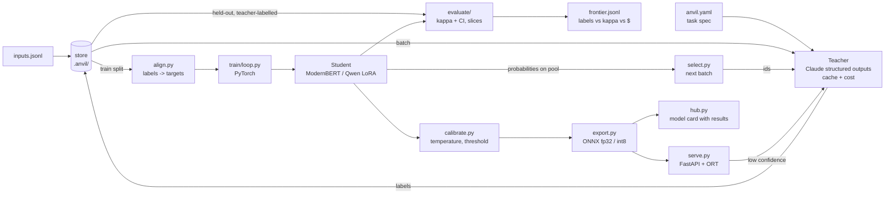

# Anvil: plan

Distil a prompted LLM call into a small, fast task model, and measure how close
the student gets to the teacher for how many labels. This file is the single
source of truth for scope and progress: a milestone is ticked only when its
definition of done is met and the quality gate is green.

## Goal

**Problem.** Teams prototype with a prompt against a frontier model and then
keep paying frontier prices and latency for a narrow, repetitive task
(ticket triage, intent routing, PII/entity extraction, short structured
rewrites). Replacing the prompt with a fine-tuned small model is the standard
fix, but each step is hand-rolled every time: label with the LLM, align the
labels to a model head, train, decide whether it is "good enough", find out
which inputs it gets wrong, export, serve. Nobody measures the one question
that decides the project: **how many teacher labels does it take to reach a
target agreement with the teacher, and what does the student still get
wrong?**

**Users.** Applied-AI and backend engineers who already have a prompt and a
stream of unlabeled inputs, and want a cheaper, faster, private drop-in with
a number attached. Anvil runs locally (CPU is enough for the encoder
students), and is driven by a CLI and a Python API.

**What Anvil does.** Given a task spec (prompt, label set or entity types or
output schema) and a JSONL of inputs, it:

1. labels a batch with the teacher (Claude, via structured outputs, cached
   and cost-accounted; Ollama as an offline fallback);
2. fine-tunes a student in PyTorch: ModernBERT for classification and span
   extraction, Qwen2.5-0.5B-Instruct with LoRA for constrained generation;
3. measures agreement with the teacher on a held-out teacher-labelled set
   (Cohen's kappa with a bootstrap CI, against a majority baseline and the
   teacher's own self-agreement ceiling), and breaks the errors down by
   class, by confidence bucket and by input length;
4. picks the next batch to label from the unlabeled pool by student
   uncertainty and diversity, and repeats until a kappa target or a dollar
   budget is hit, recording the labels-vs-kappa-vs-cost frontier;
5. calibrates the student, exports ONNX (fp32 and int8) with a parity check,
   and serves it behind a FastAPI endpoint that escalates low-confidence
   inputs back to the teacher, so a target parity is kept at a measured
   coverage;
6. publishes the student to the Hugging Face Hub with a model card that holds
   the measured parity table.

**What makes it impressive.** The hard core is the cost-versus-quality
frontier: a re-runnable study of how few teacher labels reach a target kappa,
how active selection moves that curve against random sampling, where the
student fails, and what coverage a calibrated cascade keeps at a fixed
parity. Every number in the README comes from `make eval` / `make bench` with
the dataset, method, model, seed and dollar cost recorded in RESULTS.md.

**Differentiation.** Refuel is a hosted, proprietary labelling-and-distillation
service; OpenPipe (acquired by CoreWeave in September 2025) captures
prompt/completion pairs to fine-tune LLMs, not small encoders; Argilla's
distilabel builds synthetic datasets but does not train, evaluate or serve;
Roboflow's autodistill is computer vision only. The closest research
("LLM on a Budget", arXiv 2511.11574, uncertainty sampling with randomised
accept/reject to cut teacher labels by up to 80%) is a method without a
tool. Anvil is the open-source end-to-end CLI with the measurement built in.

## Architecture

### Components

| Component | Module | Responsibility |
|---|---|---|
| Task spec | `anvil/spec.py` | Pydantic model of a task: `kind` (`classify`, `extract`, `generate`), instructions, labels / entity types / output JSON schema, teacher and student settings. Loaded from `anvil.yaml`. |
| Teacher | `anvil/teacher/` | `Teacher` protocol with `label(items) -> LabelBatch` (labels plus failures, each with its tokens and cost). `ClaudeTeacher` uses the `anthropic` SDK with structured outputs (`output_config.format`), low effort, optional Message Batches for large pools (M3), a content-addressed on-disk cache keyed by the hash of the full request, token and dollar accounting. `OllamaTeacher` is the offline fallback. `FakeTeacher` (deterministic rules) is for tests. |
| Data store | `anvil/store.py` | SQLite under `.anvil/`: inputs, labels and failed calls (append-only, with teacher model and prompt hash), splits (held-out / pool are fixed by a seeded hash of the input text so re-runs are stable), round records (M3). |
| Students | `anvil/students/` | `Student` protocol (M2; M1 has `Classifier` with `predict_proba` and `save`): `fit`, `predict_proba` / `predict_spans` / `generate`, `save`, `load`. `EncoderClassifier` and `EncoderTagger` wrap any Hugging Face encoder (default `answerdotai/ModernBERT-base`); `LoraGenerator` wraps Qwen2.5-0.5B-Instruct with PEFT LoRA. CI and unit tests use tiny random-init models built from a config, no download. |
| Trainer | `anvil/train/loop.py` | One PyTorch training loop for all students: seeded, AMP when a GPU is present, gradient accumulation, linear warmup + decay, early stopping on held-out agreement, checkpointing, structured JSONL metrics per step. |
| Alignment | `anvil/align.py` | Turns teacher outputs into training targets: label ids; character-offset spans to BIO tags over the student tokenizer's offsets (with a report of spans that could not be aligned); chat-template formatting for generation. |
| Evaluation | `anvil/evaluate/` | Agreement metrics vs the teacher: Cohen's kappa with bootstrap CI, accuracy, macro F1, confusion matrix, majority baseline, teacher self-agreement ceiling; entity-level F1 for extraction; exact match / field match for generation plus an optional judge sample. Error slices by class, confidence bucket and length. |
| Selection | `anvil/select.py` | Acquisition strategies over the unlabeled pool: `random`, `uncertainty` (entropy), `margin`, `diverse` (uncertainty with cluster coverage). One function: `select_batch(pool, k, strategy, seed)`. |
| Loop | `anvil/loop.py` | `label -> train -> eval -> select` rounds under a label or dollar budget; writes `frontier.jsonl` (round, labels, cost, kappa and CI, selection strategy, seed). |
| Calibration | `anvil/calibrate.py` | Temperature scaling on held-out logits, expected calibration error, and the confidence threshold that keeps a target kappa at the largest coverage; emits the coverage-vs-parity curve. |
| Export | `anvil/export.py` | ONNX export through `torch.onnx.export(dynamo=True)` (TorchScript exporter as the fallback), opt-in int8 dynamic quantization (per-tensor, MLP down-projections kept fp32), a logit parity check against PyTorch on held-out inputs, LoRA merge for the generator. |
| Server | `anvil/serve.py` | FastAPI app over ONNX Runtime: `/predict` returns label, confidence and `source: student | teacher`; inputs under the threshold escalate to the teacher when a key is present. Structured logs, `/healthz`, `/metrics`. |
| Hub | `anvil/hub.py` | Pushes the student with a model card rendered from the measured results (parity table, dataset, teacher, cost). |
| CLI | `anvil/cli.py` | Typer: `init`, `label`, `train`, `eval`, `select`, `loop`, `calibrate`, `export`, `serve`, `bench`, `push`. |

### Data flow

### Key design decisions

1. **Agreement with the teacher is the target metric, reported as Cohen's
   kappa with a bootstrap CI.** Accuracy against the teacher is inflated by
   class imbalance; kappa corrects for chance and is comparable across
   tasks. Every report also shows the majority-class baseline and the
   teacher's self-agreement (the same inputs labelled twice, or by a second
   model), because a student cannot be expected to agree with the teacher
   more than the teacher agrees with itself. *Rejected:* accuracy on gold
   labels as the headline (most real tasks have no gold; where a dataset
   has gold we report student-vs-gold and teacher-vs-gold as a secondary
   table).
2. **A single custom PyTorch training loop instead of the Hugging Face
   Trainer.** The loop is about 150 lines and makes AMP, accumulation,
   scheduling, early stopping and seeding explicit and testable; the same
   loop trains the classifier, the tagger and the LoRA generator. *Rejected:*
   `transformers.Trainer` (hides the mechanics the project exists to show,
   and its callback surface makes the frontier loop awkward); PyTorch
   Lightning (another dependency for the same lines of code).
3. **Fixed, hash-based splits and an append-only label store.** Held-out
   and pool membership is decided by a seeded hash of the input text, so
   adding inputs or re-running a round never moves an item across splits
   and two copies of the same text never sit on both sides (near-duplicates
   that differ by a word can; the eval reports how many). Labels are never overwritten; each carries the teacher model and
   prompt hash so a prompt change creates new labels rather than silently
   mixing. *Rejected:* random splits per run (irreproducible curves).
4. **Active learning retrains from scratch each round.** Warm-starting
   across rounds confounds the curve (a model that has seen more epochs is
   not comparable at the same label count). Each round trains a fresh
   student on all labels so far, with the same seed and budget. CPU cost is
   the price; the frontier eval keeps sequence length and epochs small and
   the GPU path (Colab) runs the full-size study. *Rejected:* warm start
   (faster, not comparable).
5. **Selection is uncertainty plus diversity, compared against random and
   against uncertainty alone.** Pure uncertainty sampling picks near
   duplicates and outliers; a cluster-coverage term fixes that at small
   batch sizes. The study reports all three so the gain is attributable.
   *Rejected:* BALD with Monte Carlo dropout (several forward passes per
   pool item; too slow on CPU for the gain reported in the literature);
   LLM-selected examples (the teacher cannot see the student's uncertainty).
6. **Calibrated cascade instead of a hard cut-over.** A temperature-scaled
   student with a threshold chosen on held-out data keeps the target kappa
   on the inputs it answers and escalates the rest to the teacher. The
   product number is "coverage at target parity", which is what a team
   needs to estimate the cost saving. *Rejected:* a learned deferral model
   (more to maintain; token-level deferral as in Gupta et al. 2024 only
   matters for the generation student, which is the last milestone).
7. **ONNX Runtime for serving, with a parity check.** The exported graph is
   compared with the PyTorch model on held-out inputs (max abs logit
   difference, agreement rate) before it can be served, for fp32 and int8.
   *Rejected:* TorchScript (deprecated path), serving PyTorch directly
   (slower on CPU, a heavier image).
8. **Structured outputs for every teacher call.** The teacher returns a
   JSON object constrained by the task's schema (`output_config.format`
   with an enum over the label names) and re-validated on the client,
   never free text parsed by regex. For extraction the
   schema carries character offsets, which `align.py` verifies against the
   input before accepting a span. *Rejected:* prompting for BIO tags
   directly (LLMs tokenise differently from the student).
9. **Offline by default, live by flag.** Unit tests use `FakeTeacher` and
   tiny random-init students; integration tests replay committed Claude
   recordings (made by `make record`; none until a key is available); live tests and evals run only with `ANTHROPIC_API_KEY` and
   are marked. Teacher calls are cached on disk so a re-run of an eval
   costs nothing.
10. **Students are pluggable.** `--student` accepts any Hugging Face
    encoder; ModernBERT-base is the default for quality, and a small
    encoder (MiniLM-L6) is the documented fast option for CPU-only runs.
    The generator defaults to Qwen2.5-0.5B-Instruct; Qwen3-0.6B is a flag.

### Stack and versions (checked 2026-10-16)

Python 3.12, uv; torch 2.14, transformers 5.20, peft 0.21, onnx 1.23 +
onnxscript 0.7, onnxruntime 1.31, anthropic 1.15, datasets 5.1,
huggingface-hub 2.2, scikit-learn 1.9, pydantic 2.14, typer 0.27,
fastapi 0.143; ruff 0.17, mypy 2.4 (strict), pytest 9.1. optimum-onnx 0.1
requires `transformers<4.58` and cannot be installed next to transformers 5,
so export goes through `torch.onnx` directly; the M1 spike
(`docs/notes/onnx-export-spike.md`) measured fp32 parity of 8e-06 for
ModernBERT-base with both exporters. The `reference_compile` hazard is gone
in transformers 5.20 (the argument now raises `TypeError`), so Anvil does not
pass it.

## Evaluation

All evals run through `make eval-*` and write their raw output under
`eval/results/`; RESULTS.md summarises them with the command, dataset slice,
models, seed, wall time and cost. Numbers that need a key or a GPU are
listed under "To measure" with the exact command until they are run.

### Datasets

| Task | Dataset | Slice | Why |
|---|---|---|---|
| classify (easy) | AG News (4 classes) | pool 2,000, held-out 500 | sanity check; near-ceiling parity expected quickly |
| classify (hard) | Banking77 (77 intents, CC-BY-4.0) | pool 2,000, held-out 500 | many classes, short inputs, where selection should matter |
| extract | MIT Restaurant (8 entity types) | pool 1,500, held-out 500 | realistic slot extraction; WNUT-17 is the alternative |
| generate | WikiSQL-style text-to-SQL (BSD) | pool 1,000, held-out 300 | constrained generation with an objective parity metric (execution match) |

Gold labels exist for all four, so each report shows student-vs-teacher
(headline), teacher-vs-gold and student-vs-gold (secondary).

### Metrics and how each number is measured

| Claim | Metric | Method |
|---|---|---|
| Parity | Cohen's kappa student-vs-teacher, 95% bootstrap CI (1,000 resamples), on the held-out teacher-labelled split | `make eval-classify`, `make eval-extract`, `make eval-generate` |
| Ceiling | Teacher self-agreement kappa on a 200-item double-labelled subset (same model, two prompt paraphrases) | part of `make eval-classify` |
| Frontier | Kappa and cost at 100, 200, 400, 800, 1,600 labels for `random`, `uncertainty`, `diverse`; 3 seeds; reported as mean and range | `make eval-frontier` |
| Labels to target | Smallest label count whose CI lower bound reaches kappa 0.8 (and 0.9), per strategy | derived from the frontier run |
| Where it fails | Per-class kappa, confusion vs teacher, agreement by confidence decile and by input length | part of every eval |
| Calibration | ECE before and after temperature scaling; coverage at target kappa 0.9 and 0.95 | `make eval-calibration` |
| Export parity | Max abs logit diff and label agreement PyTorch vs ONNX fp32 vs int8 on held-out | `make eval-export` |
| Speed and cost | p50/p95 latency and throughput of the ONNX server (batch 1 and 32, CPU, 4 threads) vs the teacher's measured latency; $ per 1,000 inputs for student (amortised label cost + compute) vs teacher | `make bench` |
| Selection unit study | Synthetic blobs with a logistic student: labels to 95% accuracy per strategy | `make eval-select` (offline, seconds) |

### Baselines

- Random sampling at every label budget (the frontier's reference curve).
- Majority class and a TF-IDF + logistic regression student trained on the
  same teacher labels (shows what the encoder adds).
- Zero-shot ModernBERT is not a thing; the honest "no training" baseline is
  the teacher itself at its cost and latency.

### Models and cost policy

The product default teacher is `claude-opus-5-5` (effort `low`, structured
outputs, cached). Evals use the cheapest model that answers the question:
`claude-haiku-5-5` for the frontier curves (about 10,000 labels across
rounds and seeds, under $2 at 2026-10 prices) and one `claude-opus-5-5` pass
on Banking77 (about $5) to show the parity table for the default teacher.
Every eval records input/output tokens and dollars from `usage`. Message
Batches halve the cost of large pools and are used when a batch exceeds
500 items.

## Release

- **Package.** `pip install anvil-distil` from PyPI (`uv build`, trusted
  publishing workflow guarded by `if: github.event_name == 'release'` and the
  presence of the publishing environment). Importable as `anvil`, CLI `anvil`.
- **Models.** Trained students publish to the Hugging Face Hub under the
  maintainer's namespace with a model card rendered from RESULTS.md. The
  push workflow needs the `HF_TOKEN` secret and runs only on manual dispatch.
- **Image.** A CPU Dockerfile for `anvil serve` (ONNX Runtime, no torch in
  the runtime stage) published to GHCR on release.
- **Demo.** A Colab notebook (`notebooks/anvil_gpu.ipynb`) that reproduces
  the GPU frontier run; a README GIF of `anvil loop` on Banking77.
- **Secrets the maintainer adds.** `ANTHROPIC_API_KEY` (evals and live tests
  in CI; optional), `HF_TOKEN` (hub push; optional), PyPI trusted publisher
  (release). Nothing else.

## Risks

| Risk | Mitigation |
|---|---|
| CPU training is slow: ModernBERT-base on 2,000 × 64 tokens × 3 epochs is roughly 40 minutes on 4 cores, and the frontier needs several retrains | Frontier on CPU uses the MiniLM fast student and 64-token inputs; the ModernBERT frontier runs on Colab (T4) from a committed notebook; results say which student produced each row |
| ModernBERT ONNX export breaks | M1 spike: both `torch.onnx` exporters export ModernBERT-base with max logit diff 8e-06; parity check gates serving. int8 is the weak part (per-tensor 0.906 argmax agreement on an untrained head, per-channel broken, dynamo graphs need stale `value_info` stripped before quantizing), so int8 is opt-in and gated on the trained model |
| Teacher labels are noisy, so the kappa ceiling is below 1 | Measure and report the teacher self-agreement ceiling; the error analysis separates "student disagrees with a consistent teacher" from "teacher is inconsistent" |
| Span alignment loses entities (teacher offsets off by one, overlapping spans) | Verify each span's text against the input, snap to token boundaries, report the unaligned rate; refuse to train when it exceeds 5% |
| Active learning gain is small on easy tasks | Report it honestly on AG News; the hard dataset (Banking77) is where the claim is made; the synthetic study isolates the mechanism |
| No key in the build environment | Harness and fixtures first; every key-requiring number listed under "To measure" with its command and cost estimate; replay recordings keep integration tests meaningful |
| Dataset licences | Banking77 CC-BY-4.0, WikiSQL BSD, MIT Restaurant public; AG News is used under its common academic terms; the loader records the licence in the run metadata and the model card |
| Dependency weight (torch + transformers + onnxruntime) | `uv` lockfile, CPU-only torch index in CI, a runtime extra (`anvil-distil[serve]`) that excludes torch |

## Plan changes

- **M1 (2026-10-16).** Export moves from optimum-onnx to `torch.onnx`
  (optimum-onnx 0.1 pins `transformers<4.58`; verified with uv's resolver).
  The `reference_compile` workaround is dropped (removed upstream in
  transformers 5.20; measured in the spike). int8 becomes opt-in with a gate
  on the trained student instead of a logit tolerance (spike: per-tensor int8
  logit diffs around 1 even in the best variant). The `tiny` test student uses
  a hand-built word-level vocabulary because the `tokenizers` trainers are not
  deterministic across processes. The RESULTS.md renderer moves to M2, where
  the first eval produces numbers to render; until then RESULTS.md cites its
  raw files table by table. Recorded fixtures: the recording and replay
  transports and the replay test are in place, but no real Claude recording
  is committed yet because the build environment has no key; `make record`
  creates them (under $0.01). Held-out membership hashes the input text
  rather than its id, so duplicate texts cannot leak across the split.
- **M2 (2026-10-17).** Early stopping uses a validation slice carved out of the
  *training* labels by a seeded text hash (10% by default), not the held-out
  split: choosing the epoch on the set the headline kappa is reported on would
  bias it upward. Evals replay committed label files (`eval/labels/`, one JSONL
  row per label with its tokens and cost) rather than per-request recordings,
  so a 2,500-label run stays one reviewable file; `make record` keeps the
  per-request recordings for the unit-level replay test. Banking77 loads from
  the `legacy-datasets/banking77` parquet mirror at a pinned revision (the
  `PolyAI/banking77` loader is a script, which `datasets` 5 no longer runs);
  `datasets` lives in a separate `eval` dependency group so CI does not install
  pyarrow. With no key in the build environment, `make eval-classify
  TEACHER=gold` runs the whole harness with each dataset's gold labels as the
  teacher (model id `gold`, never mistaken for Claude): it measures the student
  and the statistics on real data, not parity with Claude, which stays under
  "To measure" with its command and cost. The training loop resumes from
  per-epoch checkpoints (`anvil train --resume RUN`) and fingerprints the
  config and the training data, so a resume on other data is refused. The
  student and the TF-IDF baseline are scored on the same held-out items, so
  the eval compares them with a paired bootstrap of the kappa difference
  rather than by whether two separate intervals overlap.

## Milestones

- [x] M1: Scaffold, CI and a thin vertical slice — package layout, `uv` lockfile, ruff + mypy strict + pytest + GitHub Actions (lint, type, test on 3.12), Dockerfile, Makefile, MIT licence; `anvil.yaml` spec; `Teacher` protocol with `ClaudeTeacher` (structured outputs, disk cache, cost accounting, recorded fixtures, live test skipped without a key) and `FakeTeacher`; store with hash splits; `anvil label | train | eval` end to end on a toy classify task with a tiny random-init encoder; ModernBERT ONNX export spike recorded in `docs/notes/`. Done when `make check` is green in CI and `make demo` runs the slice offline in under two minutes.
- [x] M2: Training and evaluation core — `train/loop.py` (seeded, AMP, accumulation, warmup/decay, early stopping, checkpoints, JSONL metrics) with tests that assert loss decreases and resumes are exact; `EncoderClassifier` on ModernBERT-base; `evaluate/` with kappa + bootstrap CI, majority baseline, teacher self-agreement ceiling, confusion matrix and error slices; `make eval-classify` on AG News and Banking77 writing RESULTS.md (measured with Haiku if a key is present, otherwise harness + "To measure"). Done when the eval runs offline on recorded labels and the stats are verified against scikit-learn in tests.
- [ ] M3: Active learning and the frontier — `select.py` interface with the `random` baseline, property tests and the synthetic selection study; `anvil loop` with label and dollar budgets, from-scratch retrains and `frontier.jsonl`; `make eval-frontier` (3 seeds, 5 budgets, every strategy present) and `make eval-select`; RESULTS.md frontier table with "labels to kappa 0.8 / 0.9". Done when the loop runs end to end offline with the fake teacher and the frontier table is produced from real labels where a key exists.
- [ ] M4: Extraction — teacher schema with character-offset spans, `align.py` (verification, token snapping, unaligned-rate report), `EncoderTagger`, entity-level F1 and token kappa vs teacher, `make eval-extract` on MIT Restaurant. Done when alignment has tests for off-by-one, overlapping and unicode cases and the extraction eval writes its table.
- [ ] M5: Calibration, export and serving — temperature scaling and ECE, threshold search for coverage at target kappa, coverage-vs-parity curve; ONNX fp32 + int8 export with the parity gate; `anvil serve` (FastAPI + ONNX Runtime, escalation to the teacher, structured logs); `make bench` (latency, throughput, $ per 1k vs teacher); runtime Dockerfile. Done when `make eval-calibration`, `make eval-export` and `make bench` write their tables and the server's tests cover escalation with the fake teacher.
- [ ] M6: Generation student — `LoraGenerator` on Qwen2.5-0.5B-Instruct with PEFT through the same loop, chat-template alignment, execution-match parity on the text-to-SQL task plus a 100-item judge sample, merged export; Colab notebook for the GPU run. Done when the generation path trains on a tiny random-init Qwen config in CI and RESULTS.md holds either the measured parity or the exact "To measure" command and cost.
- [ ] M7: Release readiness — `anvil push` with the rendered model card, PyPI and GHCR workflows with `if:` guards, RELEASE.md with the secrets to add, README (architecture, results table, demo, roadmap), final RESULTS.md with every measured number and its cost, CONTRIBUTING.md refreshed. Done when a clean-venv wheel install runs `anvil --help` and the demo, and every README number traces to a RESULTS.md entry.
