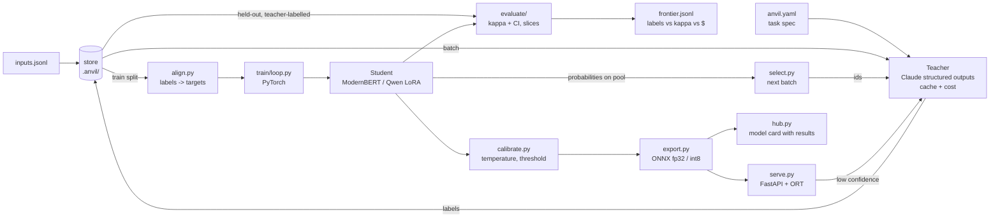

# Anvil: plan

Distil a prompted LLM call into a small, fast task model, and measure how close
the student gets to the teacher for how many labels. This file is the single
source of truth for scope and progress: a milestone is ticked only when its
definition of done is met and the quality gate is green.

## Goal

**Problem.** Teams prototype with a prompt against a frontier model and then
keep paying frontier prices and latency for a narrow, repetitive task
(ticket triage, intent routing, PII/entity extraction, short structured
rewrites). Replacing the prompt with a fine-tuned small model is the standard
fix, but each step is hand-rolled every time: label with the LLM, align the
labels to a model head, train, decide whether it is "good enough", find out
which inputs it gets wrong, export, serve. Nobody measures the one question
that decides the project: **how many teacher labels does it take to reach a
target agreement with the teacher, and what does the student still get
wrong?**

**Users.** Applied-AI and backend engineers who already have a prompt and a
stream of unlabeled inputs, and want a cheaper, faster, private drop-in with
a number attached. Anvil runs locally (CPU is enough for the encoder
students), and is driven by a CLI and a Python API.

**What Anvil does.** Given a task spec (prompt, label set or entity types or
output schema) and a JSONL of inputs, it:

1. labels a batch with the teacher (Claude, via structured outputs, cached
   and cost-accounted; Ollama as an offline fallback);
2. fine-tunes a student in PyTorch: ModernBERT for classification and span
   extraction, Qwen2.5-0.5B-Instruct with LoRA for constrained generation;
3. measures agreement with the teacher on a held-out teacher-labelled set
   (Cohen's kappa with a bootstrap CI, against a majority baseline and the
   teacher's own self-agreement ceiling), and breaks the errors down by
   class, by confidence bucket and by input length;
4. picks the next batch to label from the unlabeled pool by student
   uncertainty and diversity, and repeats until a kappa target or a dollar
   budget is hit, recording the labels-vs-kappa-vs-cost frontier;
5. calibrates the student, exports ONNX (fp32 and int8) with a parity check,
   and serves it behind a FastAPI endpoint that escalates low-confidence
   inputs back to the teacher, so a target parity is kept at a measured
   coverage;
6. publishes the student to the Hugging Face Hub with a model card that holds
   the measured parity table.

**What makes it impressive.** The hard core is the cost-versus-quality
frontier: a re-runnable study of how few teacher labels reach a target kappa,
how active selection moves that curve against random sampling, where the
student fails, and what coverage a calibrated cascade keeps at a fixed
parity. Every number in the README comes from `make eval` / `make bench` with
the dataset, method, model, seed and dollar cost recorded in RESULTS.md.

**Differentiation.** Refuel is a hosted, proprietary labelling-and-distillation
service; OpenPipe (acquired by CoreWeave in September 2025) captures
prompt/completion pairs to fine-tune LLMs, not small encoders; Argilla's
distilabel builds synthetic datasets but does not train, evaluate or serve;
Roboflow's autodistill is computer vision only. The closest research
("LLM on a Budget", arXiv 2511.11574, uncertainty sampling with randomised
accept/reject to cut teacher labels by up to 80%) is a method without a
tool. Anvil is the open-source end-to-end CLI with the measurement built in.

## Architecture

### Components

| Component | Module | Responsibility |
|---|---|---|
| Task spec | `anvil/spec.py` | Pydantic model of a task: `kind` (`classify`, `extract`, `generate`), instructions, labels / entity types / output JSON schema, teacher and student settings. Loaded from `anvil.yaml`. |
| Teacher | `anvil/teacher/` | `Teacher` protocol with `label(items) -> LabelBatch` (labels plus failures, each with its tokens and cost). `ClaudeTeacher` uses the `anthropic` SDK with structured outputs (`output_config.format`), low effort, optional Message Batches for large pools (deferred, see M3 plan changes), a content-addressed on-disk cache keyed by the hash of the full request, token and dollar accounting. `OllamaTeacher` is the offline fallback. `FakeTeacher` (deterministic rules) is for tests. |
| Data store | `anvil/store.py` | SQLite under `.anvil/`: inputs, labels and failed calls (append-only, with teacher model and prompt hash), splits (held-out / pool are fixed by a seeded hash of the input text so re-runs are stable), round records (M3). |
| Students | `anvil/students/` | `Student` protocol (M2; M1 has `Classifier` with `predict_proba` and `save`): `fit`, `predict_proba` / `predict_spans` / `generate`, `save`, `load`. `EncoderClassifier` and `EncoderTagger` wrap any Hugging Face encoder (default `answerdotai/ModernBERT-base`); `LoraGenerator` wraps Qwen2.5-0.5B-Instruct with PEFT LoRA. CI and unit tests use tiny random-init models built from a config, no download. |
| Trainer | `anvil/train/loop.py` | One PyTorch training loop for all students: seeded, AMP when a GPU is present, gradient accumulation, linear warmup + decay, early stopping on a validation slice of the training labels, checkpointing, structured JSONL metrics per step. |
| Alignment | `anvil/align.py` | Turns teacher outputs into training targets: label ids; character-offset spans to BIO tags over the student tokenizer's offsets (with a report of spans that could not be aligned); chat-template formatting for generation. |
| Evaluation | `anvil/evaluate/` | Agreement metrics vs the teacher: Cohen's kappa with bootstrap CI, accuracy, macro F1, confusion matrix, majority baseline, teacher self-agreement ceiling; entity-level F1 for extraction; exact match / field match for generation plus an optional judge sample. Error slices by class, confidence bucket and length. |
| Selection | `anvil/select.py` | Acquisition strategies over the unlabeled pool: `random`, `uncertainty` (entropy), `margin`, `diverse` (uncertainty with cluster coverage). One function: `select_batch(pool, k, strategy, seed)`. |
| Loop | `anvil/loop.py` | `label -> train -> eval -> select` rounds under a label or dollar budget; writes `frontier.jsonl` (round, labels, cost, kappa and CI, selection strategy, seed). |
| Calibration | `anvil/calibrate.py` | Temperature scaling on held-out logits, expected calibration error, and the confidence threshold that keeps a target kappa at the largest coverage; emits the coverage-vs-parity curve. |
| Export | `anvil/export.py` | ONNX export through `torch.onnx.export(dynamo=True)` (TorchScript exporter as the fallback), opt-in int8 dynamic quantization (per-tensor, MLP down-projections kept fp32), a logit parity check against PyTorch on held-out inputs, LoRA merge for the generator. |
| Server | `anvil/serve.py` | FastAPI app over ONNX Runtime: `/predict` returns label, confidence and `source: student | teacher`; inputs under the threshold escalate to the teacher when a key is present. Structured logs, `/healthz`, `/metrics`. |
| Hub | `anvil/hub.py` | Pushes the student with a model card rendered from the measured results (parity table, dataset, teacher, cost). |
| CLI | `anvil/cli.py` | Typer: `init`, `label`, `train`, `eval`, `select`, `loop`, `calibrate`, `export`, `serve`, `bench`, `push`. |

### Data flow

### Key design decisions

1. **Agreement with the teacher is the target metric, reported as Cohen's
   kappa with a bootstrap CI.** Accuracy against the teacher is inflated by
   class imbalance; kappa corrects for chance and is comparable across
   tasks. Every report also shows the majority-class baseline and the
   teacher's self-agreement (the same inputs labelled twice, or by a second
   model), because a student cannot be expected to agree with the teacher
   more than the teacher agrees with itself. *Rejected:* accuracy on gold
   labels as the headline (most real tasks have no gold; where a dataset
   has gold we report student-vs-gold and teacher-vs-gold as a secondary
   table).
2. **A single custom PyTorch training loop instead of the Hugging Face
   Trainer.** The loop is about 150 lines and makes AMP, accumulation,
   scheduling, early stopping and seeding explicit and testable; the same
   loop trains the classifier, the tagger and the LoRA generator. *Rejected:*
   `transformers.Trainer` (hides the mechanics the project exists to show,
   and its callback surface makes the frontier loop awkward); PyTorch
   Lightning (another dependency for the same lines of code).
3. **Fixed, hash-based splits and an append-only label store.** Held-out
   and pool membership is decided by a seeded hash of the input text, so
   adding inputs or re-running a round never moves an item across splits
   and two copies of the same text never sit on both sides (near-duplicates
   that differ by a word can; the eval reports how many). Labels are never overwritten; each carries the teacher model and
   prompt hash so a prompt change creates new labels rather than silently
   mixing. *Rejected:* random splits per run (irreproducible curves).
4. **Active learning retrains from scratch each round.** Warm-starting
   across rounds confounds the curve (a model that has seen more epochs is
   not comparable at the same label count). Each round trains a fresh
   student on all labels so far, with the same seed and budget. CPU cost is
   the price; the frontier eval keeps sequence length and epochs small and
   the GPU path (Colab) runs the full-size study. *Rejected:* warm start
   (faster, not comparable).
5. **Selection is uncertainty plus diversity, compared against random and
   against uncertainty alone.** Pure uncertainty sampling picks near
   duplicates and outliers; a cluster-coverage term fixes that at small
   batch sizes. The study reports all three so the gain is attributable.
   *Rejected:* BALD with Monte Carlo dropout (several forward passes per
   pool item; too slow on CPU for the gain reported in the literature);
   LLM-selected examples (the teacher cannot see the student's uncertainty).
6. **Calibrated cascade instead of a hard cut-over.** A temperature-scaled
   student with a threshold chosen on held-out data keeps the target kappa
   on the inputs it answers and escalates the rest to the teacher. The
   product number is "coverage at target parity", which is what a team
   needs to estimate the cost saving. *Rejected:* a learned deferral model
   (more to maintain; token-level deferral as in Gupta et al. 2024 only
   matters for the generation student, which is the last milestone).
7. **ONNX Runtime for serving, with a parity check.** The exported graph is
   compared with the PyTorch model on held-out inputs (max abs logit
   difference, agreement rate) before it can be served, for fp32 and int8.
   *Rejected:* TorchScript (deprecated path), serving PyTorch directly
   (slower on CPU, a heavier image).
8. **Structured outputs for every teacher call.** The teacher returns a
   JSON object constrained by the task's schema (`output_config.format`
   with an enum over the label names) and re-validated on the client,
   never free text parsed by regex. For extraction the
   schema carries character offsets, which `align.py` verifies against the
   input before accepting a span. *Rejected:* prompting for BIO tags
   directly (LLMs tokenise differently from the student).
9. **Offline by default, live by flag.** Unit tests use `FakeTeacher` and
   tiny random-init students; integration tests replay committed Claude
   recordings (made by `make record`; none until a key is available); live tests and evals run only with `ANTHROPIC_API_KEY` and
   are marked. Teacher calls are cached on disk so a re-run of an eval
   costs nothing.
10. **Students are pluggable.** `--student` accepts any Hugging Face
    encoder; ModernBERT-base is the default for quality, and a small
    encoder (MiniLM-L6) is the documented fast option for CPU-only runs.
    The generator defaults to Qwen2.5-0.5B-Instruct; Qwen3-0.6B is a flag.

### Stack and versions (checked 2026-10-16)

Python 3.12, uv; torch 2.14, transformers 5.20, peft 0.21, onnx 1.23 +
onnxscript 0.7, onnxruntime 1.31, anthropic 1.15, datasets 5.1,
huggingface-hub 2.2, scikit-learn 1.9, pydantic 2.14, typer 0.27,
fastapi 0.143; ruff 0.17, mypy 2.4 (strict), pytest 9.1. optimum-onnx 0.1
requires `transformers<4.58` and cannot be installed next to transformers 5,
so export goes through `torch.onnx` directly; the M1 spike
(`docs/notes/onnx-export-spike.md`) measured fp32 parity of 8e-06 for
ModernBERT-base with both exporters. The `reference_compile` hazard is gone
in transformers 5.20 (the argument now raises `TypeError`), so Anvil does not
pass it.

## Evaluation

All evals run through `make eval-*` and write their raw output under
`eval/results/`; RESULTS.md summarises them with the command, dataset slice,
models, seed, wall time and cost. Numbers that need a key or a GPU are
listed under "To measure" with the exact command until they are run.

### Datasets

| Task | Dataset | Slice | Why |
|---|---|---|---|
| classify (easy) | AG News (4 classes) | pool 2,000, held-out 500 | sanity check; near-ceiling parity expected quickly |
| classify (hard) | Banking77 (77 intents, CC-BY-4.0) | pool 2,000, held-out 500 | many classes, short inputs, where selection should matter |
| extract | MIT Restaurant (8 entity types) | pool 1,500, held-out 500 | realistic slot extraction; WNUT-17 is the alternative |
| generate | WikiSQL-style text-to-SQL (BSD) | pool 1,000, held-out 300 | constrained generation with an objective parity metric (execution match) |

Gold labels exist for all four, so each report shows student-vs-teacher
(headline), teacher-vs-gold and student-vs-gold (secondary).

### Metrics and how each number is measured

| Claim | Metric | Method |
|---|---|---|
| Parity | Cohen's kappa student-vs-teacher, 95% bootstrap CI (1,000 resamples), on the held-out teacher-labelled split | `make eval-classify`, `make eval-extract`, `make eval-generate` |
| Ceiling | Teacher self-agreement kappa on a 200-item double-labelled subset (same model, two prompt paraphrases) | part of `make eval-classify` |
| Frontier | Kappa and cost at 100, 200, 400, 800, 1,600 labels for `random`, `uncertainty`, `diverse`; 3 seeds; reported as mean and range | `make eval-frontier` |
| Labels to target | Smallest label count whose CI lower bound reaches kappa 0.8 (and 0.9), per strategy | derived from the frontier run |
| Where it fails | Per-class kappa, confusion vs teacher, agreement by confidence decile and by input length | part of every eval |
| Calibration | ECE before and after temperature scaling; coverage at target kappa 0.9 and 0.95 | `make eval-calibration` |
| Export parity | Max abs logit diff and label agreement PyTorch vs ONNX fp32 vs int8 on held-out | `make eval-export` |
| Speed and cost | p50/p95 latency and throughput of the ONNX server (batch 1 and 32, CPU, 4 threads) vs the teacher's measured latency; $ per 1,000 inputs for student (amortised label cost + compute) vs teacher | `make bench` |
| Selection unit study | Synthetic blobs with a logistic student: labels to 95% accuracy per strategy | `make eval-select` (offline, seconds) |

### Baselines

- Random sampling at every label budget (the frontier's reference curve).
- Majority class and a TF-IDF + logistic regression student trained on the
  same teacher labels (shows what the encoder adds).
- Zero-shot ModernBERT is not a thing; the honest "no training" baseline is
  the teacher itself at its cost and latency.

### Models and cost policy

The product default teacher is `claude-opus-5-5` (effort `low`, structured
outputs, cached). Evals use the cheapest model that answers the question:
`claude-haiku-5-5` for the frontier curves (about 10,000 labels across
rounds and seeds, under $2 at 2026-10 prices) and one `claude-opus-5-5` pass
on Banking77 (about $5) to show the parity table for the default teacher.
Every eval records input/output tokens and dollars from `usage`. Message
Batches halve the cost of large pools and are used when a batch exceeds
500 items.

## Release

- **Package.** `pip install anvil-distil` from PyPI (`uv build`, trusted
  publishing workflow guarded by `if: github.event_name == 'release'` and the
  presence of the publishing environment). Importable as `anvil`, CLI `anvil`.
- **Models.** Trained students publish to the Hugging Face Hub under the
  maintainer's namespace with `anvil push`, which writes a model card rendered
  from the student's own eval report, calibration, export gates and label
  cost. It runs on the machine that trained the student and reads `HF_TOKEN`
  from the environment (changed in M7: a dispatch workflow would have to
  retrain the student, since trained students are not in the repository).
- **Image.** A CPU Dockerfile for `anvil serve` (ONNX Runtime, no torch in
  the runtime stage) published to GHCR on release.
- **Demo.** A Colab notebook (`notebooks/anvil_gpu.ipynb`) that reproduces
  the GPU frontier run; a README GIF of `anvil loop` on Banking77.
- **Secrets the maintainer adds.** `ANTHROPIC_API_KEY` (evals and live tests
  in CI; optional), `HF_TOKEN` (in the shell that runs `anvil push`, not a
  repository secret; optional), PyPI trusted publisher bound to the `pypi`
  environment (release). GHCR uses the workflow's `GITHUB_TOKEN`. Nothing
  else. The exact steps are in RELEASE.md.

## Risks

| Risk | Mitigation |
|---|---|
| CPU training is slow: ModernBERT-base on 2,000 × 64 tokens × 3 epochs is roughly 40 minutes on 4 cores, and the frontier needs several retrains | Frontier on CPU uses the MiniLM fast student and 64-token inputs; the ModernBERT frontier runs on Colab (T4) from a committed notebook; results say which student produced each row |
| ModernBERT ONNX export breaks | M1 spike: both `torch.onnx` exporters export ModernBERT-base with max logit diff 8e-06; parity check gates serving. int8 is the weak part (per-tensor 0.906 argmax agreement on an untrained head, per-channel broken, dynamo graphs need stale `value_info` stripped before quantizing), so int8 is opt-in and gated on the trained model |
| Teacher labels are noisy, so the kappa ceiling is below 1 | Measure and report the teacher self-agreement ceiling; the error analysis separates "student disagrees with a consistent teacher" from "teacher is inconsistent" |
| Span alignment loses entities (teacher offsets off by one, overlapping spans) | Verify each span's text against the input, snap to token boundaries, report the unaligned rate; refuse to train when it exceeds 5% |
| Active learning gain is small on easy tasks | Report it honestly on AG News; the hard dataset (Banking77) is where the claim is made; the synthetic study isolates the mechanism |
| No key in the build environment | Harness and fixtures first; every key-requiring number listed under "To measure" with its command and cost estimate; replay recordings keep integration tests meaningful |
| Dataset licences | Banking77 CC-BY-4.0, WikiSQL BSD, MIT Restaurant public; AG News is used under its common academic terms; the loader records the licence in the run metadata and the model card |
| Dependency weight (torch + transformers + onnxruntime) | `uv` lockfile, CPU-only torch index in CI, a runtime extra (`anvil-distil[serve]`) that excludes torch |

## Plan changes

- **M1 (2026-10-16).** Export moves from optimum-onnx to `torch.onnx`
  (optimum-onnx 0.1 pins `transformers<4.58`; verified with uv's resolver).
  The `reference_compile` workaround is dropped (removed upstream in
  transformers 5.20; measured in the spike). int8 becomes opt-in with a gate
  on the trained student instead of a logit tolerance (spike: per-tensor int8
  logit diffs around 1 even in the best variant). The `tiny` test student uses
  a hand-built word-level vocabulary because the `tokenizers` trainers are not
  deterministic across processes. The RESULTS.md renderer moves to M2, where
  the first eval produces numbers to render; until then RESULTS.md cites its
  raw files table by table. Recorded fixtures: the recording and replay
  transports and the replay test are in place, but no real Claude recording
  is committed yet because the build environment has no key; `make record`
  creates them (under $0.01). Held-out membership hashes the input text
  rather than its id, so duplicate texts cannot leak across the split.
- **M2 (2026-10-17).** Early stopping uses a validation slice carved out of the
  *training* labels by a seeded text hash (10% by default), not the held-out
  split: choosing the epoch on the set the headline kappa is reported on would
  bias it upward. Evals replay committed label files (`eval/labels/`, one JSONL
  row per label with its tokens and cost) rather than per-request recordings,
  so a 2,500-label run stays one reviewable file; `make record` keeps the
  per-request recordings for the unit-level replay test. Banking77 loads from
  the `legacy-datasets/banking77` parquet mirror at a pinned revision (the
  `PolyAI/banking77` loader is a script, which `datasets` 5 no longer runs);
  `datasets` lives in a separate `eval` dependency group so CI does not install
  pyarrow. With no key in the build environment, `make eval-classify
  TEACHER=gold` runs the whole harness with each dataset's gold labels as the
  teacher (model id `gold`, never mistaken for Claude): it measures the student
  and the statistics on real data, not parity with Claude, which stays under
  "To measure" with its command and cost. The training loop resumes from
  per-epoch checkpoints (`anvil train --resume RUN`) and fingerprints the
  config and the training data, so a resume on other data is refused. The
  student and the TF-IDF baseline are scored on the same held-out items, so
  the eval compares them with a paired bootstrap of the kappa difference
  rather than by whether two separate intervals overlap. A second training
  seed moved AG News kappa by 0.053 (about 70% of one run's interval width)
  and left Banking77's unchanged while flipping 15% of its predictions, which
  confirms M3's three seeds per frontier point. Known gap: a recorded Claude
  run with a refused input cannot be replayed (the replay teacher treats any
  missing label as an incomplete recording); M3 records refusals alongside
  labels before the first paid frontier run.
- **M3 (2026-10-17).** The known gap above is closed: label files record
  teacher failures (refusals, truncated or invalid answers) as rows with a
  `reason`, a replay returns them with their original reason and cost at $0
  spent, and only inputs with no row at all count as an incomplete
  recording. `select.py` ships the `select_batch(pool, k, strategy, seed)`
  interface, the `random` baseline and a contract test suite (property tests
  with hypothesis plus oracle cases) for all four strategies; `uncertainty`,
  `margin` and `diverse` are declared and their tests are expected failures
  until they are written, so `make eval-frontier` and `make eval-select`
  report them as "not implemented yet" and the measured curves are the
  random reference. Round 0 of every loop is a random draw that depends only
  on the seed, so all strategies of a seed share their first student. The
  CPU frontier student is MiniLM-L6 (the risk table's fast option), trained
  for a fixed length (at least 600 optimizer steps, five epochs once the set
  is large) without early stopping: at 100 labels a 10% validation slice is
  ten inputs for up to 77 classes, and in a pilot (output not kept) it
  stopped training at epoch 4 and kept an untrained epoch 1.
  `StudentSpec.min_steps` provides the fixed length; the learning rate (5e-4)
  was picked in the same pilot, scored on pool inputs outside the training
  slice, never on the held-out split. "Labels to
  kappa t" is reported two ways: the smallest budget whose mean kappa over
  three seeds reaches t, and the smallest at which every seed's 95% interval
  lies above t. The loop's dollar budget counts label cost (what the labels
  cost to make), not spend, so a replay stops where the live run did; it
  covers the held-out labels too, which are bought first. No key exists in
  the build environment, so the frontier is measured with gold labels as the
  teacher (`TEACHER=gold`); the Claude frontier is under "To measure".
  Message Batches are deferred: a frontier buys at most about 2,500 labels
  per dataset, shared by every strategy and seed, which the per-input cached
  requests handle; batching returns when a pool is large enough to need it.
- **M4 (2026-10-18).** The teacher returns each mention's `text`, `type` and
  claimed `start` (no `end`: the end is the start plus the text's length, so
  the two cannot disagree); the schema has no `minimum` on `start` because
  structured outputs do not support numeric bounds. The text is trusted and
  the offset is only a hint: `align.py` matches each mention by the strictest
  of six rules that finds it (exact, shifted to the nearest occurrence, case,
  whitespace, NFC, trimmed punctuation) and never lets a match split a letter
  from its combining accent. Answers are stored raw (the mentions' canonical
  JSON in the label column), so alignment runs at train and eval time and can
  change without paying for labels again; the store, cache, label files and
  replay needed no change. Among several occurrences of a mention's text the
  one on word boundaries wins, then the nearest to the claimed offset ("in" is
  not found inside "dining" while a whole word "in" exists); an identical
  mention listed twice takes a second occurrence when the text has one and is
  a duplicate otherwise. Overlapping spans keep the longer (BIO cannot nest).
  A span the `max_length` cut runs through is dropped as `truncated` rather
  than trained as a stump.
  The 5% unaligned gate counts drops at both stages, text and tokens, and runs
  before the first training step. Token kappa is computed over whitespace
  words, not the student's subword tokens, so it is comparable across
  students; both extraction intervals resample sentences, not words. MIT
  Restaurant is read from the T-NER copy's raw JSON files at a pinned revision
  with `huggingface_hub` (its loader script does not run under `datasets` 5),
  sampled at 2,000 sentences with a 25% held-out fraction (about 500 held-out,
  1,500 pool). The baseline is a gazetteer of the teacher's training spans
  rather than TF-IDF, which does not tag spans. An alignment stress study
  (gold offsets corrupted the ways a model gets them wrong) runs on every
  invocation and measures the repair rules on real sentences. `anvil loop`
  refuses extract tasks: selection over spans is not in this milestone. No key
  exists in the build environment, so the extraction table uses the gold
  annotation as the teacher; Claude parity is under "To measure".
- **M5 (2026-10-19).** Calibration, export and the server measure the M2 students (the
  same ModernBERT-base runs as the parity table: retraining them reproduced the committed
  training log step for step), so their numbers are comparable with it; `eval/student.py`
  finds the student in the eval workspace by its recorded settings or trains it the same way.
  Temperature scaling fits T on the held-out teacher labels; when the fit runs to a bound
  (the student agrees with every one of them, or its few errors have nearly flat logits) the
  NLL has no minimum and T stays 1 (a toy run sent it to the lower bound, where every input,
  nonsense included, scored 1.0 and nothing could escalate). The
  threshold is the largest coverage whose kappa on the answered inputs reaches the target,
  by default on a one-sided 95% bootstrap lower bound rather than the point estimate; the
  in-sample choice is checked out of sample by refitting T and the threshold on random halves
  of the held-out split and scoring the other half. A calibration that finds no threshold
  makes the server escalate every input, so such a bundle is refused without a teacher unless
  a threshold is given explicitly. Export writes a bundle (fp32 graph, optional int8
  graph, `tokenizer.json`, metadata with the calibration, the parity results and the task
  spec, so the server can rebuild the teacher) and only moves it into place when fp32 matches
  PyTorch; tokenization in the parity check goes through the serving tokenizer, so a
  tokenizer mismatch fails the gate too. The int8 gate changed after the first measurement:
  the spike's rule (argmax agreement with fp32 of at least 0.98 on every held-out input)
  rejected the Banking77 int8 graph at 0.964, yet its kappa with the teacher moved by 0.002
  and every one of its flips was on an input the cascade escalates. Agreement is now
  measured on the inputs the student answers at the bundle's threshold under fp32 or int8
  (int8's own confidence decides when it is served; all inputs when there is no threshold),
  still with the 0.01 kappa-drop limit on every input, and the overall agreement is reported
  next to it. The int8 graph runs the probes as the fp32 check does, batched and the first
  16 one at a time: dynamic quantization scales activations per batch, so an input's int8
  logits depend on its batch mates, and a served request is often one input. The committed
  export table predates the single-input runs (RESULTS.md, To measure). The probe also found
  what the spike guessed: quantizing only the MLP down-projections takes agreement to 3%, so
  they stay fp32.
  `anvil serve` imports neither torch nor transformers (a test enforces it), and the serving
  image installs the lock file's serving dependencies without them. Export and serving cover
  classify students; serving the extraction tagger is not in this milestone. `make bench` is
  an eval module rather than an `anvil bench` command; its student cost is measured CPU time
  priced at a stated vCPU-hour rate (an input, not a measurement). With no key, the teacher
  is the gold labels throughout, so teacher latency and cost per 1,000 inputs are under "To
  measure".
- **M6 (2026-10-20).** A `generate` task lists its answer fields under `outputs` (strings);
  the teacher returns them through structured outputs and the store keeps them as one
  canonical JSON object, so classify and extract prompt hashes are unchanged. A one-field
  answer is trained as its bare value, not JSON: wrapping SQL would make the student escape
  every double-quoted column name. The student is trained on its own chat template around
  a system message (the task's instructions, not the teacher's JSON-format prompt) and the
  input; prompt tokens are masked, and `anvil/chat.py` checks rather than assumes that the
  generation prompt is a token prefix of the training sequence, that the answer ends with the
  end-of-turn token (what the template adds after it is not trained), and that the answer's
  tokens decode back to the teacher's text. An example longer than `max_length` is dropped,
  never cut, under the same 5% gate as span alignment. The training loop gained
  `trainable_only` checkpoints (the adapter, not 2 GB of frozen base per copy). Early
  stopping uses greedy exact match on the validation slice with the validation loss as a
  bounded tie-break: exact match stays 0 for several epochs at first, and a stop on that tie
  kept the first epoch. Decoding is greedy with every setting written out, because Qwen's
  shipped generation config samples and sets a repetition penalty of 1.1, which penalises
  exactly the column names SQL has to repeat. "Merged export" is the adapter folded into the
  base weights as a plain transformers checkpoint, gated on identical completions and logits
  within 1e-3 against the adapter model; ONNX for a decoder needs a KV-cache graph and a
  decoding loop, which is left out. WikiSQL is read from the Hub's parquet conversion at a
  pinned commit (its loader is a script), each gold query rendered as SQLite over a table
  named `t`; execution match runs both queries in an in-memory, authorizer-restricted,
  step-limited SQLite copy of the question's table with case-insensitive text columns (as
  WikiSQL's own evaluator). Because a small table lets different queries return the same rows,
  the report also gives strict normalised-SQL match, execution match on questions whose
  reference returns a row, and the judge sample, which compares a Claude judge's verdicts
  with execution match item by item (it needs a key: "To measure"). The baseline is the base
  model zero-shot on the same prompt. With no key the teacher is WikiSQL's own queries
  (`TEACHER=gold`). `anvil loop` and `anvil calibrate` stay classify-only, and serving the
  generator is not in this milestone. Scoring found that 22 of 300 WikiSQL references aggregate over
  no matching rows and return one `NULL` row, which any other aggregate over nothing matches,
  and 8 more are a `COUNT` over no matching rows, which returns 0 and matches any `COUNT` with
  a wrong filter. A reference now counts as empty when it returns the same result on a copy of
  its table with no rows, a definition that needs no list of aggregates. Since training and
  greedy decoding are deterministic, `eval.generate --rescore` scores a run's stored queries
  again instead of retraining for two hours; the report keeps the raw completions and the
  zero-shot per-item results so a later scorer change can be replayed from the committed file.
  A recorded judge verdict is keyed by the question and a hash of the exact pair judged, since
  the candidate is the student's query and changes with every retrain; the rubric states that
  text compares case-insensitively, as the sandbox does. The review of this milestone also
  bounded the sandbox's result size (the row and length caps were independent, so ten
  thousand rows of large blobs could exhaust memory, and the quadratic built-ins run inside
  one VM instruction where the step limit cannot interrupt them: the length cap is 10 KB and
  results have a byte budget), made an answer longer than `max_new_tokens` a counted drop
  (it trained fine and could never be generated in full), stripped bare targets (a leading
  newline merges with the template's own into one Qwen token, so the prompt was no longer a
  prefix), and added the base model's own end tokens to the stop set (Qwen2.5-Instruct's
  tokenizer names only `<|im_end|>` while its generation config also stops on
  `<|endoftext|>`; the stored WikiSQL completions show neither leaked, so no number changed).

- **M7 (2026-10-21).** `anvil push` takes an export (an ONNX bundle or a merged generator),
  writes a model card into it as `README.md` and uploads the directory to a Hub model repo,
  private unless `--public`. Every number in the card is read from files next to the student:
  the `anvil eval` report, found two directories above the export (`<workspace>/exports/<run>`,
  which also covers the eval harness's workspaces) or under `ANVIL_HOME/<task>`, and only if it
  measured the same teacher and prompt; the calibration and parity gates in the export metadata;
  the label cost from the store. The store does not record which labels a student trained on,
  so the cost is every label for that teacher and prompt, and the card says so. Bundles now
  record their student run (`run`) so the report can be found. The Hub push is a local command
  rather than a dispatch workflow (Release section). The release workflow runs on a published
  GitHub release (a manual run builds and checks only): a tag-version check, `uv build`, the
  clean-venv wheel check, then PyPI by trusted publishing and both images to GHCR, each guarded
  by `if: github.event_name == 'release'` and the repository name. The wheel check resolves
  dependencies from PyPI with CPU torch, not from `uv.lock`, so it tests the published ranges;
  `huggingface-hub` became a declared dependency (it was only transitive through
  `transformers`). Training packages stay core dependencies: `anvil-distil` without torch could
  only serve, and the serving image already installs that subset from the lock file. RESULTS.md
  gained a generated spend ledger (every committed run, its command, commit, wall time and
  dollars). No new measurement needed a key; Claude parity stays under "To measure".

## Evolution round 1 (2026-10-21)

v1 is merged (M1-M7). Before calling the project finished I re-ran what the repository can
measure without a key and asked what the results leave unanswered.

**Evidence.**

- `make check`: 926 passed, 1 skipped, 24 xfailed (the owner's selection strategies), 2 min 11 s.
  `make demo`: 98 s, output identical to the README. `make eval-select` reproduces the committed
  report byte for byte apart from wall time (16 s against 25 s).
- Every number in RESULTS.md has the dataset's gold labels as the teacher. The "teacher
  ceiling" column is `n/a` in all four parity tables, teacher-vs-gold is never shown, and the
  question the project is named for (how close does the student get to a *fallible* teacher,
  and does it copy the teacher's mistakes) has not been observed once. `OllamaTeacher` is in
  the component table but not in the code (`anvil/teacher/` has `claude`, `fake`, `labelfile`).
- A pilot with a local open model as the teacher (Ollama 0.40.7, `qwen2.5:3b`, the repo's own
  system prompt and JSON schema as the `format`, temperature 0, `num_ctx` 2048, the first 60
  inputs of the `make eval-classify` sample (`eval.data.sample` with the config's size and seed,
  pool and held-out mixed), one `POST /api/chat` per input from a throwaway client script; the
  rows are not committed, M8's labels of the same sample supersede them, and a re-run of the
  first 15 Banking77 inputs returned the same 15 labels):
  Banking77 33/60 agree with gold (kappa 0.54), 0 invalid outputs, median 1.7 s per label with
  the system prompt prefix-cached (about 505 prompt tokens per request); the same 60 under the paraphrased ceiling prompt
  agree with the first pass 47/60; AG News 46/60 (median 2.5 s). `qwen2.5:7b` scores 36/60 on
  Banking77 at 3.8 s per label and agrees with the 3B model on 40/60. So a laptop can label
  the whole 2,700-input sample in about 1.5 h, with a teacher noisy enough to make the
  measurement interesting (the student trained on gold reaches 0.842).
- The cascade's product number (82.3% coverage at kappa 0.9 on Banking77) was chosen and
  checked only on halves of the same held-out split. `anvil/calibrate.py` escalates on
  confidence alone, and a toy run in M5 already showed every input, nonsense included,
  scoring 1.0 when the temperature fit ran to its bound. Nothing measures what the served
  bundle does with inputs from another distribution.
- The one-sided 95% percentile bound behind the threshold rule kept the target in 90.5% and
  87.0% of unseen halves. That is not a coverage measurement (the unseen half's own estimate
  is noisy, and the rule takes the best of many thresholds), so whether the bound itself covers
  95% has never been measured; `anvil/evaluate/bootstrap.py` names BCa as the upgrade and
  its coverage test covers one regime (kappa 0.7, 200 items, 5 labels), while the rule is
  applied at kappa 0.9-0.97 on about 400 accepted inputs with 4 or 77 labels.

**New milestones.**

- **M8, the first fallible teacher.** Question: when the teacher is a small open model, is
  student-vs-teacher kappa bounded by the teacher's paraphrase self-agreement, and does the
  student agree with gold more than its teacher does? Hypotheses (3B teacher, from the pilot):
  teacher-vs-gold kappa 0.50-0.60 on Banking77 and 0.65-0.75 on AG News; ceiling kappa about
  0.75 on Banking77; student-vs-teacher below the ceiling; student-vs-gold above teacher-vs-gold
  by at least 0.05 on AG News, where the teacher's errors look unsystematic, and within 0.05 of
  it on Banking77, where the pilot's repeated confusions (`reverted_card_payment` labelled
  `cancel_transfer`, `automatic_top_up` labelled `top_up_by_card_charge`) should reappear in
  the student's confusion matrix; and the lower-bound rule finds no threshold at kappa 0.9 on
  Banking77, because no student can reach 0.9 with a teacher whose self-agreement is below it,
  so the target must be read against the ceiling (the ceiling is measured on all inputs and the
  rule on the confident ones, where the teacher may be more consistent: a threshold found
  there refutes this part, and the run reports the ceiling on the accepted inputs too). A matched synthetic control (gold labels
  corrupted at the teacher's measured error rate, once uniformly and once through fixed
  confusion pairs) says which of the two kinds of noise the real teacher is.
  Command: `make eval-classify TEACHER=ollama` on both datasets (labels land in `eval/labels/`
  and every later run replays them at $0, with no Ollama server), then
  `make eval-calibration TEACHER=ollama` and `make eval-noise`. About 5 h of laptop CPU in
  all: 1.3 h of labelling and about 1 h of ModernBERT training per dataset (the gold
  Banking77 run took 57 min), plus the MiniLM control.
- **M9, the cascade off-distribution.** Question: what does the served Banking77 bundle do with
  inputs it was never meant to see? Hypotheses: on Banking77's own test split coverage stays
  within 3 points of 82.3% and kappa on the answered inputs stays at or above 0.9; on CLINC150's
  out-of-scope utterances the student answers at least 40% above the served threshold with a
  label that is wrong by construction; a free score from the same forward pass (max logit or
  energy, or distance to the training embeddings) separates in- from out-of-distribution
  inputs with an AUROC at least 0.05 above max-softmax at under 3 points of in-distribution
  coverage. Command: `make eval-shift TEACHER=gold`.
- **M10, does the interval cover?** Question: at the kappa, sample size and label count where
  `choose_threshold` applies it, does the one-sided 95% percentile bound cover 95%? Hypotheses:
  at kappa 0.95 with 250 items it covers 88-92%, BCa (bias and acceleration from the jackknife,
  computed from marginals like the replicates) 93-96%, and at 77 labels with 100 items both
  show an estimator bias no interval fixes; switching the rule to BCa costs at most 3 points of
  coverage on the committed Banking77 logits; and the threshold search itself (the largest
  coverage whose bound clears the target, over every candidate threshold) holds the target less
  often than a single bound at a fixed threshold. Command: `make eval-coverage` (a simulation,
  minutes, offline) and `make eval-calibration` from `logits.npz`.

**Rejected.**

- A committee of three seeds as the escalation signal: about 5 h of ModernBERT retrains per
  dataset, the argmax changes with the ensemble so the coverage gain is confounded, and it
  triples the serving cost the bench exists to minimise.
- MiniLM against ModernBERT under one recipe with three seeds: about 10 h of CPU for a
  comparison the frontier (0.820 at 1,600) and the parity table (0.842 at 2,000) already
  bound, and "halves the seed range" cannot be falsified with three draws.
- Variance decomposition on the frontier (five seeds): worthwhile, but it is the error bar for
  the owner's strategy study and belongs with it.
- Selective prediction for the generator: the "query runs" signal is dead for the trained
  student (4 errors in 300), so it reduces to a token-probability threshold; a later round.
- Length-bucketed batching in the server: a half-day with a predictable answer, and the
  cascade serves batch 1.
- The strategies in `anvil/select.py`: reserved, as before.

**Review.** I re-ran `make check` (926 passed, 1 skipped, 24 xfailed, 2 min 14 s) and
`make eval-select` (byte-identical apart from wall time and commit), recomputed every pilot
figure from its rows, and re-labelled 15 Banking77 inputs with `qwen2.5:3b` (15/15 the same).
Kept all three milestones. Sharpened: M8 gets a time budget, replays its labels as
`TEACHER=ollama`, and reports the ceiling on the accepted inputs, since that is where the
threshold rule applies; M10 also simulates the threshold search, because the rule picks the
best of many thresholds and a fixed-threshold coverage study would miss that selection
effect. The pilot's note and raw rows moved out of this change (a plan change touches only
PLAN.md and the roadmap); the method is above.

## Milestones

- [x] M1: Scaffold, CI and a thin vertical slice — package layout, `uv` lockfile, ruff + mypy strict + pytest + GitHub Actions (lint, type, test on 3.12), Dockerfile, Makefile, MIT licence; `anvil.yaml` spec; `Teacher` protocol with `ClaudeTeacher` (structured outputs, disk cache, cost accounting, recorded fixtures, live test skipped without a key) and `FakeTeacher`; store with hash splits; `anvil label | train | eval` end to end on a toy classify task with a tiny random-init encoder; ModernBERT ONNX export spike recorded in `docs/notes/`. Done when `make check` is green in CI and `make demo` runs the slice offline in under two minutes.
- [x] M2: Training and evaluation core — `train/loop.py` (seeded, AMP, accumulation, warmup/decay, early stopping, checkpoints, JSONL metrics) with tests that assert loss decreases and resumes are exact; `EncoderClassifier` on ModernBERT-base; `evaluate/` with kappa + bootstrap CI, majority baseline, teacher self-agreement ceiling, confusion matrix and error slices; `make eval-classify` on AG News and Banking77 writing RESULTS.md (measured with Haiku if a key is present, otherwise harness + "To measure"). Done when the eval runs offline on recorded labels and the stats are verified against scikit-learn in tests.
- [x] M3: Active learning and the frontier — `select.py` interface with the `random` baseline, property tests and the synthetic selection study; `anvil loop` with label and dollar budgets, from-scratch retrains and `frontier.jsonl`; `make eval-frontier` (3 seeds, 5 budgets, every strategy present) and `make eval-select`; RESULTS.md frontier table with "labels to kappa 0.8 / 0.9". Done when the loop runs end to end offline with the fake teacher and the frontier table is produced from real labels where a key exists.
- [x] M4: Extraction — teacher schema with character-offset spans, `align.py` (verification, token snapping, unaligned-rate report), `EncoderTagger`, entity-level F1 and token kappa vs teacher, `make eval-extract` on MIT Restaurant. Done when alignment has tests for off-by-one, overlapping and unicode cases and the extraction eval writes its table.
- [x] M5: Calibration, export and serving — temperature scaling and ECE, threshold search for coverage at target kappa, coverage-vs-parity curve; ONNX fp32 + int8 export with the parity gate; `anvil serve` (FastAPI + ONNX Runtime, escalation to the teacher, structured logs); `make bench` (latency, throughput, $ per 1k vs teacher); runtime Dockerfile. Done when `make eval-calibration`, `make eval-export` and `make bench` write their tables and the server's tests cover escalation with the fake teacher.
- [x] M6: Generation student — `LoraGenerator` on Qwen2.5-0.5B-Instruct with PEFT through the same loop, chat-template alignment, execution-match parity on the text-to-SQL task plus a 100-item judge sample, merged export; Colab notebook for the GPU run. Done when the generation path trains on a tiny random-init Qwen config in CI and RESULTS.md holds either the measured parity or the exact "To measure" command and cost.
- [x] M7: Release readiness — `anvil push` with the rendered model card, PyPI and GHCR workflows with `if:` guards, RELEASE.md with the secrets to add, README (architecture, results table, demo, roadmap), final RESULTS.md with every measured number and its cost, CONTRIBUTING.md refreshed. Done when a clean-venv wheel install runs `anvil --help` and the demo, and every README number traces to a RESULTS.md entry.
- [ ] M8: The first fallible teacher — `OllamaTeacher` (`provider: ollama`, the same system prompt, JSON schema, parsing, disk cache and label files as the Claude teacher; tokens from Ollama's counts, dollars $0 with CPU seconds recorded, the model pinned by its digest in `meta.json`), `--teacher ollama` in the classification harness so the labels are committed under `eval/labels/` and replay for free, `make eval-classify TEACHER=ollama` on AG News and Banking77 with `qwen2.5:3b` (teacher-vs-gold, the paraphrase ceiling, student-vs-teacher and student-vs-gold with paired intervals, the teacher's confusions against the student's), `make eval-calibration TEACHER=ollama` on those labels (replayed from `eval/labels/`; the ceiling also reported on the accepted inputs), and `make eval-noise` (gold corrupted at the measured teacher error rate, uniform and confusion-pair, 3 seeds, the frontier's MiniLM student) as the control. Done when the first non-gold parity table is in RESULTS.md with its ceiling and teacher-vs-gold rows, the student-vs-gold against teacher-vs-gold comparison is stated with its paired interval, and the unit tests cover the Ollama teacher with a scripted transport.
- [ ] M9: The cascade off-distribution — `eval/shift.py` (`make eval-shift`) scores an exported bundle through `anvil/runtime.py` on Banking77's test split (coverage, kappa on the answered inputs, ECE), CLINC150's out-of-scope utterances and AG News sentences (acceptance rate above the served threshold, confidence histograms), and compares max-softmax with max-logit or energy and with distance to the training embeddings by AUROC and in-distribution coverage cost; the model card states that coverage was measured in-distribution. Done when RESULTS.md holds the shift table with the hypotheses answered, and the loaders are pinned by revision with licences recorded.
- [ ] M10: Does the interval cover? — BCa intervals in `anvil/evaluate/bootstrap.py` (jackknife from marginals, one-sided variant), `make eval-coverage` (a simulation over kappa {0.85, 0.9, 0.95}, items {100, 250, 500}, labels {4, 77}: coverage of the percentile and BCa bounds, point-estimate bias, and how often the threshold search's chosen threshold truly meets the target), `choose_threshold` on the BCa bound with the coverage cost measured from the committed `logits.npz`. Done when the simulation runs in CI in under a minute, RESULTS.md holds the coverage table and the re-run calibration tables, and the default rule is whichever the table justifies, with the reason written down.
