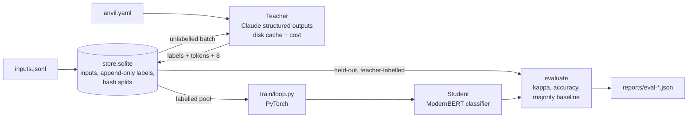

# Anvil

**Distil LLM calls into small, fast task models, with measured parity.**

Teams prototype a narrow task (ticket triage, intent routing, entity
extraction) as a prompt against a frontier model, then keep paying frontier
prices and latency for it. Replacing the prompt with a fine-tuned small model
is the standard fix, but every team hand-rolls it, and almost nobody measures
the question that decides whether it worked: **how many teacher labels does
the student need to agree with the teacher, and where does it still disagree?**

Anvil takes a task spec and a file of unlabeled inputs. It labels them with
Claude (structured outputs, cached, every call costed), fine-tunes a small
model in PyTorch, and measures the student's agreement with the teacher on a
held-out, teacher-labelled split as Cohen's kappa. Later milestones add
uncertainty-driven selection of the next batch to label, calibration, ONNX
export with a parity gate, and a server that escalates low-confidence inputs
back to the teacher.

Status: **M1 of 7** (scaffold, Claude teacher, label store, and the
`label -> train -> eval` slice). See [PLAN.md](PLAN.md) for the milestones.

## Demo

```console
$ make demo
== anvil label (fake teacher, offline)
labelled 91 held-out + 200 pool inputs with fake-rules-c7ee422d (0 from cache, $0.0000 spent); 291 labels in store worth $0.0000
== anvil train (tiny random-init ModernBERT)
trained 20261016-191004-n200 on 200 fake-rules-c7ee422d labels: 10 epochs, loss 2.441 -> 0.173, 0.9s
== anvil eval (held-out agreement with the teacher)
student 20261016-191004-n200 vs fake-rules-c7ee422d on 91 held-out inputs: kappa 0.896, accuracy 0.923 (majority 'bug' accuracy 0.209); report .anvil/demo/ticket-triage/reports/eval-20261016-191004-n200.json
== demo finished in 18s
```

The demo runs offline: the teacher is a keyword-rule `FakeTeacher` with 5%
injected label noise and the student is a two-layer random-init ModernBERT
with a vocabulary built from the pool, so it finishes quickly on
a laptop CPU (18 s here, most of it Python start-up across three commands). Its kappa is a smoke check of the pipeline, not a result.

<!-- GIF placeholder: record `anvil label/train/eval` against Claude with
`vhs docs/demo.tape` (or asciinema + agg) once real labels exist, save it as
docs/screenshots/demo.gif and link it here. -->

## Quickstart

```bash
git clone https://github.com/TheAsianFish/anvil && cd anvil
uv sync --all-extras            # Python 3.12, CPU torch from the PyTorch index
make demo                       # offline slice on the toy task

# With Claude as the teacher (spends money; every call is cached and costed):
export ANTHROPIC_API_KEY=...
cd examples/toy
uv run anvil label --inputs inputs.jsonl --n 200     # held-out split + 200 pool inputs
uv run anvil train                                   # student.model: answerdotai/ModernBERT-base for real runs
uv run anvil eval
```

A task is a YAML file:

```yaml
name: ticket-triage
kind: classify
instructions: |
  You route customer support tickets to the team that should handle them.
labels:
  - name: billing
    description: charges, invoices, refunds, payment methods, plans and pricing
  - name: bug
    description: something in the product is broken, crashes or returns an error
teacher: {provider: claude, model: claude-opus-5-5, effort: low}
student: {model: answerdotai/ModernBERT-base, max_length: 64, epochs: 3, learning_rate: 5.0e-5}
splits: {heldout_fraction: 0.25, seed: 0}
```

Inputs are JSONL, one `{"text": ..., "id": optional}` per line. State lives
under `ANVIL_HOME` (default `.anvil/`): the SQLite label store, the teacher
response cache and trained students.

Docker (the container runs as uid 1000, so pass your uid to write into the
bind mount):

```bash
make docker
docker run --rm -u "$(id -u):$(id -g)" -v "$PWD:/work" -e ANTHROPIC_API_KEY anvil:dev label --spec anvil.yaml --inputs inputs.jsonl --n 200
docker run --rm -u "$(id -u):$(id -g)" -v "$PWD:/work" anvil:dev label --spec anvil.yaml --inputs inputs.jsonl --teacher fake   # offline
```

## Architecture



| Module | Role |
|---|---|
| `anvil/spec.py` | Pydantic task spec; the prompt hash keys every label |
| `anvil/teacher/` | `Teacher` protocol; `ClaudeTeacher` (one structured-output request per input, enum-constrained label, content-addressed disk cache, token and dollar accounting); transports for the live API, recording and replay; `FakeTeacher` for offline runs |
| `anvil/store.py` | SQLite store: inputs, append-only labels (triggers reject UPDATE and DELETE), held-out membership from a seeded hash of the input text; failed teacher calls kept with their cost |
| `anvil/students/encoder.py` | Any Hugging Face encoder with a classification head; `tiny` builds a random-init ModernBERT for tests and the demo |
| `anvil/train/loop.py` | The PyTorch training loop (M2 extends it with warmup, AMP, accumulation, early stopping, resume) |
| `anvil/evaluate/metrics.py` | Cohen's kappa, accuracy, majority baseline, confusion matrix |
| `anvil/pipeline.py`, `anvil/cli.py` | `label`, `train`, `eval` as a library API and a Typer CLI |

**The hard part** (the core of the project, built over M2 and M3) is the
cost-versus-quality frontier: how few teacher labels reach a target kappa
with the teacher, how active selection moves that curve against random
sampling, and where the student still fails. M1 lays the ground it needs:
labels are keyed by (teacher model, prompt hash) so curves never mix two
prompts, splits are a pure function of the input text so re-runs never move an
item, and every label carries its cost so a curve can be drawn in dollars.

## Design decisions

- **Agreement with the teacher, as Cohen's kappa.** Accuracy against the
  teacher is inflated by class imbalance; kappa corrects for chance. Each
  report shows the majority-class baseline next to it.
- **One request per input, with an enum-constrained JSON schema.** Batching
  several inputs into one prompt is cheaper per token, but per-input requests
  make the cache per input (adding inputs only pays for new ones) and let the
  schema guarantee a valid label. Invalid outputs, truncation, refusals and
  an input too long for the teacher are recorded as failures, never guessed.
- **No server-side model fallback on refusal.** A fallback would answer with
  a different model under the same key and silently mix two teachers in one
  agreement measurement. A refused input is reported and retried next run.
- **Hash-based splits and an append-only store.** Held-out membership is a
  seeded hash of the input *text*, so adding inputs never moves an item and
  two copies of the same text can never sit on both sides. Labels and failed
  calls are never overwritten; a change to the instructions, labels or
  teacher effort creates a new key, and a student trained under other split
  settings is refused at eval time.
- **Every billed call is accounted, including failures.** A refused or
  truncated response still costs its input and thinking tokens, so failures
  are stored with their cost and count toward the dollars spent. Two inputs
  with the same text are one request, and when a run stops early (a
  configuration error, Ctrl-C) the answers that were already paid for are
  stored before the error surfaces.
- **A deterministic tiny student.** `tiny` uses a word-level vocabulary built
  by hand: the `tokenizers` WordPiece trainer breaks frequency ties in
  hash-map order, which gave a different vocabulary, and a different trained
  model, in every process.
- **Offline by default.** Unit tests use `FakeTeacher`, a scripted transport
  and tiny models, with the network blocked; live tests run only with a key;
  recorded Claude responses replay through the same parsing code (none are
  committed yet; `make record` creates them once a key exists).
- **ONNX export goes through `torch.onnx`.** `optimum-onnx` 0.1 requires
  `transformers<4.58` and cannot be installed next to transformers 5; the M1
  spike in [docs/notes/onnx-export-spike.md](docs/notes/onnx-export-spike.md)
  measures the `torch.onnx` path for ModernBERT-base.

## Results

Every number comes from a command in [CONTRIBUTING.md](CONTRIBUTING.md) with
its raw output under `eval/results/`. See [RESULTS.md](RESULTS.md) for what
has been measured so far (the ONNX export spike) and the exact commands and
cost estimates for what has not (everything that needs a key or a GPU).

## Roadmap

- [x] M1: scaffold, CI, Claude teacher with cache and cost accounting, label store, offline slice, ONNX export spike
- [ ] M2: full training loop and evaluation core (bootstrap CI, teacher self-agreement ceiling, error slices); AG News and Banking77 parity
- [ ] M3: active learning and the labels-vs-kappa-vs-cost frontier
- [ ] M4: span extraction with character-offset alignment
- [ ] M5: calibration, ONNX export with a parity gate, FastAPI server with teacher escalation, benchmarks
- [ ] M6: Qwen2.5-0.5B LoRA generation student
- [ ] M7: release (PyPI, GHCR, Hugging Face model cards)

## License

MIT
