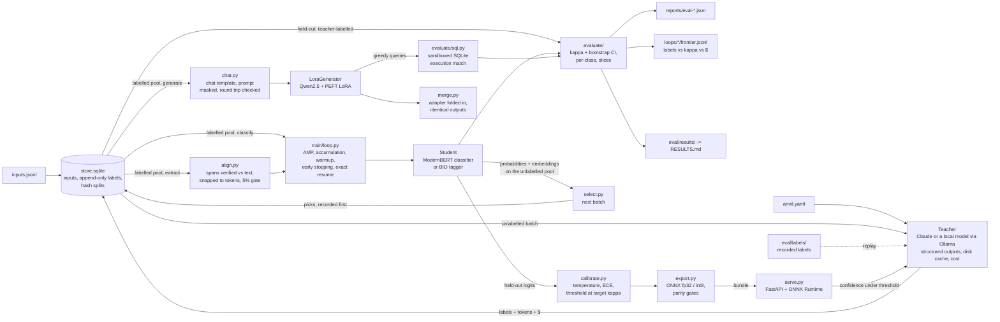

# Anvil

**Distil LLM calls into small, fast task models, with measured parity.**

Teams prototype a narrow task (ticket triage, intent routing, entity
extraction) as a prompt against a frontier model, then keep paying frontier
prices and latency for it. Replacing the prompt with a fine-tuned small model
is the standard fix, but every team hand-rolls it, and almost nobody measures
the question that decides whether it worked: **how many teacher labels does
the student need to agree with the teacher, and where does it still disagree?**

Anvil takes a task spec and a file of unlabeled inputs. It labels them with
Claude (structured outputs, cached, every call costed), fine-tunes a small
model in PyTorch, and measures the student's agreement with the teacher on a
held-out, teacher-labelled split as Cohen's kappa. For extraction the teacher
returns each entity's text and character offset; Anvil verifies every span
against the input, repairs the offsets a language model gets wrong, refuses
to train when too many spans cannot be aligned, and scores a token tagger by
entity F1 and token kappa. `anvil loop` grows the
training set round by round (pick, label, retrain from scratch, score) under
a label and a dollar budget and records the labels-vs-kappa-vs-cost frontier.
`anvil calibrate` fits a temperature and picks the confidence threshold that
keeps a target kappa on the inputs the student answers; `anvil export` writes
an ONNX bundle that must match PyTorch before it can be served; `anvil serve`
answers over HTTP from ONNX Runtime (no torch in the image) and sends the
inputs under the threshold back to the teacher. For free-text answers
(`kind: generate`, text-to-SQL here) the student is Qwen2.5-0.5B-Instruct
with a LoRA adapter, trained on its own chat template and scored by
execution match: the student's query and the teacher's run against the
question's table in a sandboxed SQLite and must return the same rows.

Status: **0.1.0, release-ready** (all seven milestones in [PLAN.md](PLAN.md)).
The package builds a wheel that installs into a clean venv and runs the demo
(`make wheel-check`); the release workflow publishes to PyPI and GHCR when a
GitHub release is published, and `anvil push` uploads a student to the
Hugging Face Hub with a model card written from its measured numbers
([RELEASE.md](RELEASE.md)). Every number below was measured with the
dataset's gold labels standing in for the teacher: no Claude label has been
bought yet, and the runs that need one are listed with their cost under
"To measure" in [RESULTS.md](RESULTS.md).

## Demo

```console
$ make demo
== anvil label (fake teacher, offline)
labelled 91 held-out + 200 pool inputs with fake-rules-bbf26b5d (0 from cache, $0.0000 spent); 291 labels in store worth $0.0000
== anvil train (tiny random-init ModernBERT)
trained 20261020-142608-n200 on 200 fake-rules-bbf26b5d labels (16 held back for early stopping, best epoch 4, kappa 0.916): 6 epochs, loss 1.899 -> 0.196, 0.5s
== anvil eval (held-out agreement with the teacher)
student 20261020-142608-n200 vs fake-rules-bbf26b5d on 91 held-out inputs: kappa 1.000 [1.000, 1.000], accuracy 1.000 (majority 'bug' accuracy 0.209); report .anvil/demo/ticket-triage/reports/eval-20261020-142608-n200.json
== anvil calibrate (temperature and the threshold that keeps kappa 0.9 with the teacher)
calibrated 20261020-142608-n200 on 91 held-out fake-rules-bbf26b5d labels: temperature 1.000, ECE 0.020 -> 0.020
threshold 0.8821: the student answers 100.0% of held-out inputs at kappa 1.000, lower bound 0.956 (target 0.9); written to .anvil/demo/ticket-triage/students/20261020-142608-n200/calibration.json
== anvil export (ONNX fp32, checked against PyTorch before it can be served)
fp32: passed parity vs pytorch on 91 inputs: max |logit diff| 1.91e-06, agreement 1.000, kappa vs teacher 1.000 (drop +0.000); 0.7 MB (max |logit diff| <= 1e-04 and agreement == 1.0)
bundle .anvil/demo/bundle; serve it with `anvil serve .anvil/demo/bundle`
== anvil serve (ONNX Runtime; inputs under the threshold escalate to the fake teacher)
  billing          from the student  (confidence 0.988)
  feature_request  from the student  (confidence 0.995)
  account          from the teacher  (confidence 0.870)
== anvil loop (random selection, three rounds, fresh student each round)
loop demo (random, seed 0) vs fake-rules-bbf26b5d:
  round  labels  kappa [95% CI]          label cost  spent
      0      50  0.582 [0.452, 0.697]  $   0.0000  $0.0000
      1     100  0.881 [0.793, 0.955]  $   0.0000  $0.0000
      2     200  0.836 [0.738, 0.923]  $   0.0000  $0.0000
== anvil label (extraction, fake teacher with off-by-one offsets)
labelled 72 held-out + 240 pool inputs with fake-rules-680a73ed (0 from cache, $0.0000 spent); 312 labels in store worth $0.0000
== anvil train (tiny random-init ModernBERT tagger; aligns every answer first)
aligned 548 teacher mentions: 430 at their offset, 118 repaired (shifted 118), 0 dropped (0.0%), 0 snapped to token boundaries
trained 20261020-142649-n240 on 240 fake-rules-680a73ed labels (21 held back for early stopping, best epoch 3, entity F1 1.000): 5 epochs, loss 1.752 -> 0.015, 0.5s
== anvil eval (entity F1 and token kappa against the teacher)
student 20261020-142649-n240 vs fake-rules-680a73ed on 72 held-out inputs: entity F1 0.929 [0.885, 0.968] (precision 0.904, recall 0.955), token kappa 0.968 [0.949, 0.985] (held-out teacher mentions: 37 repaired, 0 dropped, 0.0%); report .anvil/demo/restaurant-slots/reports/eval-20261020-142649-n240.json
== anvil label (generation, fake teacher writes one SQL query per question)
labelled 52 held-out + 120 pool inputs with fake-rules-25a3538a (0 from cache, $0.0000 spent); 172 labels in store worth $0.0000
== anvil train (LoRA on a tiny random-init Qwen2; chat template, prompt tokens masked)
aligned 120 answers to the chat template: 0 dropped (none, 0.0%); longest sequence 332 tokens
trained 20261020-142707-n120 on 120 fake-rules-25a3538a labels (17 held back for early stopping, best epoch 6, validation score (exact match, loss as tie-break) 0.005): 6 epochs, loss 5.369 -> 5.276, 7.2s
== anvil eval (greedy answers vs the teacher's; a random-init 2-layer decoder learns the
   shape of the queries, not yet to copy values: real parity comes from Qwen2.5-0.5B)
student 20261020-142707-n120 vs fake-rules-25a3538a on 52 held-out inputs: exact match 0.000 [0.000, 0.000] (per field: sql 0.000); 0 invalid answers; report .anvil/demo/toy-sql/reports/eval-20261020-142707-n120.json
== anvil export (adapter merged into the base weights, same answers or nothing is written)
merged: passed parity vs the adapter on 52 held-out inputs: 52/52 identical completions, max |logit diff| 3.58e-07 on 8; 0.4 MB (max abs logit diff <= 0.001 and every completion identical)
merged model .anvil/demo/toy-sql/exports/20261020-142707-n120-merged (a plain transformers checkpoint)
== demo finished in 91s
```

The demo runs offline (loop warnings and its last line trimmed above): the
teacher is a keyword-rule `FakeTeacher` with 5% injected label noise for
classification and, for extraction, a fifth of its offsets moved by one
character, which alignment repairs (118 of 548 here). The first toy student
is calibrated (it agrees with every held-out label, so its temperature stays
1 and the threshold is its lowest held-out confidence), exported to ONNX and
served; of the three requests, the one under the threshold is answered by the
teacher. The students are two-layer random-init ModernBERTs with a
vocabulary built from the pool and, for SQL, a two-layer random-init Qwen2
over bytes with a LoRA adapter: it learns the shape of a query, not yet to
copy the values, so its exact match is 0 here; the merged export still has to
reproduce its answers exactly. The demo finishes in about a minute and a half
on a laptop CPU, most of it Python start-up for each command. Its numbers are a
smoke check of the pipeline, not results.

<!-- GIF placeholder: record `anvil label/train/eval` against Claude with
`vhs docs/demo.tape` (or asciinema + agg) once real labels exist, save it as
docs/screenshots/demo.gif and link it here. -->

## Quickstart

As a package (Python 3.12; once published, see [RELEASE.md](RELEASE.md)):

```bash
pip install "anvil-distil[export,serve]"   # on a CPU-only Linux box, install torch from
                                           # https://download.pytorch.org/whl/cpu first
anvil --help
```

From a checkout, with the demo, the tests and the evals:

```bash
git clone https://github.com/TheAsianFish/anvil && cd anvil
uv sync --all-extras            # Python 3.12, CPU torch from the PyTorch index
make demo                       # offline slice on the toy task

# With Claude as the teacher (spends money; every call is cached and costed):
export ANTHROPIC_API_KEY=...
cd examples/toy
uv run anvil label --inputs inputs.jsonl --n 200     # held-out split + 200 pool inputs
uv run anvil train                                   # student.model: answerdotai/ModernBERT-base for real runs
uv run anvil eval
uv run anvil train --resume <run-id>                 # continue an interrupted run from its checkpoint

# Active learning: 100, 200, 400 labels, a fresh student each round, stop at $1 of labels
uv run anvil loop --budgets 100,200,400 --max-usd 1.00 --strategy random --id first
uv run anvil loop --budgets 100,200,400 --max-usd 1.00 --strategy random --id first  # resumes

# The parity eval on AG News and Banking77 (downloads the datasets and ModernBERT-base):
make eval-classify                    # with a key: labels with Claude Haiku once, replays after
make eval-classify TEACHER=gold       # no key: dataset gold labels as the teacher
make eval-classify TEACHER=ollama     # no key: qwen2.5:3b as a fallible teacher (replays eval/labels/;
                                      # labelling anew needs `ollama serve`, ~1.5 h per dataset on CPU)
make eval-noise                       # the control: the same student on matched synthetic noise (~2 h)
make eval-frontier TEACHER=gold       # kappa vs labels, 3 seeds x 5 budgets per strategy (CPU, ~2.5 h)
make eval-select                      # the strategies on synthetic blobs (seconds)
make eval-extract TEACHER=gold        # span extraction on MIT Restaurant (ModernBERT-base tagger, CPU)
make eval-extract-cascade             # the tagger's threshold on entity F1, from the committed predictions (20 s)

# Calibrate, export and serve (classify tasks)
uv run anvil calibrate --target-kappa 0.9            # temperature + threshold, on held-out labels
uv run anvil export --int8                           # ONNX bundle, parity-gated, under .anvil/<task>/exports/
uv run anvil serve .anvil/ticket-triage/exports/<run> --teacher claude   # POST /predict {"texts": [...]}
make eval-calibration eval-export TEACHER=gold       # the M2 students: threshold study, int8 layer probe
make bench TEACHER=gold                              # PyTorch vs ONNX Runtime vs HTTP, CPU, 4 threads

# Extraction: the same three commands on a `kind: extract` spec
cd examples/toy-extract
uv run anvil label --inputs inputs.jsonl --n 200 --teacher fake
uv run anvil train --teacher fake     # aligns every answer first; refuses above 5% unaligned
uv run anvil eval                     # entity F1 and token kappa with bootstrap intervals

# Generation: text-to-SQL with a LoRA student, scored by execution match
cd ../toy-generate
uv run anvil label --inputs inputs.jsonl --n 200 --teacher fake
uv run anvil train --teacher fake     # student.model: Qwen/Qwen2.5-0.5B-Instruct for real runs
uv run anvil eval                     # exact match per field (execution match is in make eval-generate)
uv run anvil export                   # the adapter merged into the base, gated on identical outputs
make eval-generate TEACHER=gold       # WikiSQL, 1,000 labels, Qwen2.5-0.5B on CPU (~2 h) or Colab

# Publish a student with its model card (parity, calibration, export gates, label cost)
uv run anvil push .anvil/ticket-triage/exports/<run> --repo <you>/ticket-triage --dry-run
HF_TOKEN=... uv run anvil push .anvil/ticket-triage/exports/<run> --repo <you>/ticket-triage
```

A task is a YAML file:

```yaml
name: ticket-triage
kind: classify
instructions: |
  You route customer support tickets to the team that should handle them.
labels:
  - name: billing
    description: charges, invoices, refunds, payment methods, plans and pricing
  - name: bug
    description: something in the product is broken, crashes or returns an error
teacher: {provider: claude, model: claude-opus-5-5, effort: low}
student: {model: answerdotai/ModernBERT-base, max_length: 64, epochs: 3, learning_rate: 5.0e-5}
splits: {heldout_fraction: 0.25, seed: 0}
```

An extraction task has `kind: extract` and lists entity types under
`labels`; see [examples/toy-extract/anvil.yaml](examples/toy-extract/anvil.yaml).
A generation task has `kind: generate` and lists its answer fields under
`outputs`; see [examples/toy-generate/anvil.yaml](examples/toy-generate/anvil.yaml).

Inputs are JSONL, one `{"text": ..., "id": optional}` per line. State lives
under `ANVIL_HOME` (default `.anvil/`): the SQLite label store, the teacher
response cache and trained students.

`POST /predict` answers each input with its label, the student's confidence,
`source` (`student` or `teacher`) and whether it was escalated; a teacher
failure falls back to the student's answer with the reason in `error`.
`/healthz` and `/metrics` (Prometheus text) come with it, and every request is
one JSON log line with counts and latency, never the input text.

Docker (the container runs as uid 1000, so pass your uid to write into the
bind mount):

```bash
make docker
docker run --rm -u "$(id -u):$(id -g)" -v "$PWD:/work" -e ANTHROPIC_API_KEY anvil:dev label --spec anvil.yaml --inputs inputs.jsonl --n 200
docker run --rm -u "$(id -u):$(id -g)" -v "$PWD:/work" anvil:dev label --spec anvil.yaml --inputs inputs.jsonl --teacher fake   # offline

# The serving image: ONNX Runtime and the Rust tokenizer, no torch; mount a bundle at /model
docker run --rm -p 8000:8000 -v "$PWD/.anvil/ticket-triage/exports/<run>:/model:ro" anvil-serve:dev --teacher none
```

## Architecture



| Module | Role |
|---|---|
| `anvil/spec.py` | Pydantic task spec; the prompt hash keys every label |
| `anvil/teacher/` | `Teacher` protocol; `RequestTeacher` (one structured-output request per input, duplicates sent once, content-addressed disk cache, answers decoded against the task's schema) behind `ClaudeTeacher` (token and dollar accounting) and `OllamaTeacher` (a local open model with the same prompt and schema, $0 with the server's seconds recorded, the weights pinned by digest); transports for the live API, recording and replay; `FakeTeacher` for offline runs |
| `anvil/store.py` | SQLite store: inputs, append-only labels (triggers reject UPDATE and DELETE), held-out membership from a seeded hash of the input text; failed teacher calls kept with their cost |
| `anvil/students/encoder.py` | Any Hugging Face encoder with a classification head; `tiny` builds a random-init ModernBERT for tests and the demo |
| `anvil/train/loop.py` | One generic PyTorch loop: seeded batches, gradient accumulation, AMP, warmup + linear decay, clipping, early stopping, per-epoch checkpoints that resume bit for bit |
| `anvil/train/classifier.py` | Cross-entropy for the encoder classifier; early stopping on the kappa of a validation slice of the training labels |
| `anvil/evaluate/` | Kappa and accuracy with vectorised percentile and BCa bootstrap CIs (the jackknife from marginals), Clopper-Pearson and Wilson bounds on the agreement count mapped to kappa, macro F1, per-class scores, top confusions, teacher self-agreement, slices by confidence and input length; for extraction, exact-match entity F1, word-level tag kappa, an error breakdown (boundary, type, missed, spurious) and intervals that resample inputs |
| `anvil/spans.py`, `anvil/align.py` | Extraction answers as mentions (text, type, claimed offset); alignment verifies each against the input with a ladder of repair rules, resolves overlaps, snaps spans to student tokens as BIO tags and reports every repair and drop |
| `anvil/students/tagger.py`, `anvil/train/tagger.py` | `EncoderTagger`: any encoder with a fast tokenizer and a token-classification head, trained by the same loop with early stopping on validation entity F1 |
| `eval/extract.py` | `make eval-extract` on MIT Restaurant: gazetteer baseline, ceiling, gold comparison and the alignment stress study |
| `anvil/teacher/labelfile.py` | Replays recorded labels (or a dataset's gold labels, as model `gold`) offline |
| `eval/classify.py`, `eval/render.py` | `make eval-classify` (with `TEACHER=ollama`, a fallible teacher: teacher vs gold, the paired student-minus-teacher interval against gold, what the student does with the teacher's errors) and the RESULTS.md renderer |
| `eval/noise.py` | `make eval-noise`: the same student on gold, on the local teacher's labels and on gold corrupted at the teacher's error rate (uniformly, or through the teacher's own confusion matrix on random inputs) |
| `anvil/select.py` | `select_batch(pool, k, strategy, seed)`: `random` (the reference curve); `uncertainty`, `margin` and `diverse` are declared with a contract test suite and not written yet |
| `anvil/loop.py` | `anvil loop`: rounds of select, label, retrain from scratch, score; label, dollar and target-kappa stops; picks stored before labelling so an interrupted loop resumes to the same rows |
| `eval/frontier.py`, `eval/select_study.py` | `make eval-frontier` (3 seeds x 5 budgets per strategy) and `make eval-select` (synthetic blobs, logistic student) |
| `anvil/calibrate.py` | Temperature scaling (bisection on the NLL gradient), ECE and reliability bins, the coverage-vs-kappa curve, and the threshold search on the point estimate, a one-sided percentile or BCa bootstrap lower bound, or an exact (default) or Wilson bound on the agreement count; numpy only |
| `anvil/export.py`, `anvil/runtime.py` | `torch.onnx` (dynamo) export with dynamic batch and sequence axes, fp32 parity gate through the serving tokenizer, opt-in int8 with the MLP down-projections in fp32; `OnnxStudent` loads a bundle with ONNX Runtime and `tokenizers`, never torch |
| `anvil/serve.py` | `anvil serve`: FastAPI `/predict`, `/healthz`, `/metrics`; inputs under the threshold go to the teacher in one batch per request; every teacher failure degrades to the student's answer |
| `eval/calibration.py`, `eval/export.py`, `eval/bench.py` | `make eval-calibration` (temperature, coverage, and the split study of whether a threshold holds on unseen inputs), `make eval-export` (parity and the int8 layer probe), `make bench` |
| `anvil/chat.py`, `anvil/students/generator.py`, `anvil/train/generator.py` | The generation student: each answer placed in the model's own chat template with the prompt tokens masked, checked (the generation prompt is a token prefix, the answer ends at end-of-turn and decodes back to the teacher's text); `LoraGenerator` (PEFT LoRA on every linear layer, greedy decoding with every setting explicit; `tiny` is a random-init two-layer Qwen2 over bytes); early stopping on validation exact match |
| `anvil/evaluate/sql.py`, `anvil/evaluate/judge.py`, `anvil/merge.py` | Execution match in an in-memory SQLite copy of the question's table (authorizer, step limit, case-insensitive text); a Claude judge on a seeded sample, compared item by item with execution match; the adapter merged into the base weights, kept only if it answers the probes exactly as the adapter did |
| `eval/generate.py`, `eval/wikisql.py` | `make eval-generate` on WikiSQL: zero-shot baseline, rows-doubled check, slices, judge sample, merged export; `--rescore` scores stored queries again without retraining |
| `anvil/hub.py` | `anvil push`: a Hugging Face model card rendered from the export's own files (the `anvil eval` report, calibration, parity gates, label cost; "not measured" when a report is missing), then the export uploaded to a private repo by default |
| `anvil/pipeline.py`, `anvil/cli.py` | `label`, `train`, `eval`, `loop`, `calibrate`, `export`, `serve`, `push` as a library API and a Typer CLI |
| `scripts/wheel_check.sh`, `.github/workflows/release.yml` | The release gate (the built wheel in a fresh venv runs `anvil --help` and the demo) and the release workflow: PyPI by trusted publishing and both images to GHCR, only when a GitHub release is published |

**The hard part** (the core of the project, built over M2 and M3) is the
cost-versus-quality frontier: how few teacher labels reach a target kappa
with the teacher, how active selection moves that curve against random
sampling, and where the student still fails. M2 built the measuring
instrument: kappa with a bootstrap interval verified against scikit-learn and
scipy (and a coverage simulation), a ceiling from the teacher's own
self-agreement, slices that show where the student disagrees, and a training
loop whose runs are reproducible to the bit. M1 laid the ground it needs:
labels are keyed by (teacher model, prompt hash) so curves never mix two
prompts, splits are a pure function of the input text so re-runs never move an
item, and every label carries its cost so a curve can be drawn in dollars. M4
extends the instrument to extraction, where the hard part is upstream of
training: a teacher's character offsets are unreliable, so every span is
verified against the input and repaired by a ladder of matching rules, snapped
to the student's tokens, and counted; a teacher whose spans cannot be aligned
stops training instead of silently teaching the student the wrong targets.
M5 turns the measurement into the product number, coverage at a target
parity: a temperature-scaled student answers what it is sure of and
escalates the rest, with the threshold checked on inputs it was not chosen
on, because a threshold that reaches the target in-sample misses it on new
data about half the time (RESULTS.md). M6 carries the instrument to free
text, where agreement needs a definition: two SQL queries agree when they
return the same rows, but on a small table different queries often do, so
the report also counts matches that break when every row is doubled and
references that return nothing.

## Design decisions

- **Agreement with the teacher, as Cohen's kappa.** Accuracy against the
  teacher is inflated by class imbalance; kappa corrects for chance. Each
  report shows the majority-class baseline next to it.
- **One request per input, with an enum-constrained JSON schema.** Batching
  several inputs into one prompt is cheaper per token, but per-input requests
  make the cache per input (adding inputs only pays for new ones) and let the
  schema guarantee a valid label. Invalid outputs, truncation, refusals and
  an input too long for the teacher are recorded as failures, never guessed.
- **No server-side model fallback on refusal.** A fallback would answer with
  a different model under the same key and silently mix two teachers in one
  agreement measurement. A refused input is reported and retried next run.
- **Hash-based splits and an append-only store.** Held-out membership is a
  seeded hash of the input *text*, so adding inputs never moves an item and
  two copies of the same text can never sit on both sides. Labels and failed
  calls are never overwritten; a change to the instructions, labels or
  teacher effort creates a new key, and a student trained under other split
  settings is refused at eval time.
- **Every billed call is accounted, including failures.** A refused or
  truncated response still costs its input and thinking tokens, so failures
  are stored with their cost and count toward the dollars spent. Two inputs
  with the same text are one request, and when a run stops early (a
  configuration error, Ctrl-C) the answers that were already paid for are
  stored before the error surfaces.
- **Intervals, not point estimates.** Kappa comes with a 95% percentile
  bootstrap interval over held-out items (1,000 paired resamples, computed
  for all resamples at once from per-resample marginals). Two students
  scored on the same items are compared with a paired bootstrap of the
  difference, not by whether their separate intervals overlap: overlapping
  intervals do not make two students tied.
- **Early stopping never looks at the held-out split.** The epoch is chosen
  on a validation slice of the training labels (10%, picked by a hash of the
  text); choosing it on the reported split would bias the headline upward.
- **Exact resume.** A checkpoint holds the model, optimizer, scheduler,
  gradient scaler, both RNGs, the epoch's data order and position, and the
  early-stopping state, fingerprinted with the config and the training data;
  an interrupted run resumed from it ends with bit-identical weights
  (`tests/test_train_loop.py` crashes it at five points on CPU; on CUDA that holds only with deterministic
  kernels).
- **No key, no fake parity.** Without a key, `make eval-classify
  TEACHER=gold` uses the dataset's own labels as the teacher under the model
  id `gold`, so the harness and the student are measured on real data while
  Claude parity stays under "To measure".
- **For extraction the copied text is evidence, the offset is a hint.** A
  language model reads tokens, so its character offsets drift (off by one,
  counted in UTF-16 units past an emoji, counted in words) while the text it
  copies is usually exact. Alignment matches each mention to an occurrence of
  its text, from the strictest rule (the exact offset) to the loosest (case,
  whitespace, Unicode normalisation, trimmed punctuation), takes the occurrence
  nearest the claimed offset, and records which rule fired. *Rejected:*
  asking the teacher for BIO tags (it tokenises differently from the student)
  and trusting offsets (a plain check loses almost every shifted span; see the
  stress table in RESULTS.md).
- **Overlaps keep the longer span; training stops above 5% unaligned.** BIO
  tags cannot hold nested entities, so the longer of two overlapping spans
  wins and the other is counted as dropped. When more than 5% of a teacher's
  mentions cannot be aligned to the text or the student's tokens, the prompt
  or the labels are broken and `anvil train` refuses (exit code 2) before the
  first step, with examples in the report.
- **Extraction is scored two ways, with intervals over sentences.** Exact-match
  entity F1 is what a consumer of the extractions sees; kappa over each word's
  BIO tag gives partial credit and is chance-corrected like the classification
  number. The bootstrap resamples sentences, not words: words of one sentence
  are not independent draws.
- **Every round retrains from scratch.** A warm-started student at 400
  labels has had more updates than a fresh one, so its kappa would mix "more
  labels" with "more training". Each round trains a new student with the same
  seed and settings on every label so far; CPU time is the price.
- **Round 0 is shared.** The first batch is a random draw that depends only
  on the seed, so every strategy of a seed starts from the same student and
  the curves differ only from the first selected batch on (a paired
  comparison, not two unrelated runs).
- **Picks are written before labels.** A loop records each round's picks in
  the store, then labels them. An interrupted loop resumes with the same
  picks and, training being seeded, ends with the same rows as one that never
  stopped (tested by crashing a round). A refused pick keeps its slot in the
  budget and is never paid for twice.
- **Dollar budgets count label cost, not spend.** A label replayed from the
  cache or a recording counts what it cost to make, so a replay stops at the
  same round as the live run it reproduces.
- **Fixed-length training on the frontier.** At 100 labels a 10% validation
  slice is ten inputs for up to 77 classes, too few to choose an epoch on (a
  pilot, whose output was not kept, showed early stopping misfiring). Frontier
  rounds train for at least 600 optimizer steps instead (`min_steps`).
- **A deterministic tiny student.** `tiny` uses a word-level vocabulary built
  by hand: the `tokenizers` WordPiece trainer breaks frequency ties in
  hash-map order, which gave a different vocabulary, and a different trained
  model, in every process.
- **Offline by default.** Unit tests use `FakeTeacher`, a scripted transport
  and tiny models, with the network blocked; live tests run only with a key;
  recorded Claude responses replay through the same parsing code (none are
  committed yet; `make record` creates them once a key exists).
- **The cascade threshold is set on a lower bound, not the estimate.** The
  threshold is the largest coverage whose kappa on the answered inputs
  reaches the target; picking it on the point estimate fits the sample's
  noise, so fresh inputs land below the target about as often as above.
  `anvil calibrate` uses a one-sided 95% lower bound by default (the exact
  count bound since M11) and `make eval-calibration` measures every rule on
  held-out halves the threshold never saw. *Rejected:* a learned deferral model (more to
  maintain for a gain the plain threshold already measures).
- **An exact bound on the agreement count, not the bootstrap (M10, M11).**
  `make eval-coverage` simulates each bound where the rule uses it. Both
  bootstrap methods cover about 93% instead of 95% (pooled 93.1% and 93.0%),
  and BCa is worse at 77 labels, where it reads ties on the discrete
  disagreement count as bias. Bounding that count directly brings coverage
  to about nominal. The
  one-sided Clopper-Pearson bound on the agreement rate, mapped to kappa
  through the answered inputs' chance term, covers 96.5% pooled, every cell
  within Monte Carlo error of 95% (worst 94.4%). The threshold it picks truly keeps its target in 96.7%
  of searches, against 90.8% for the percentile rule. It costs 1.4 points
  of served coverage on Banking77 and 8.8 on AG News at kappa 0.9; the cost
  does not follow the label count and looks like it follows how flat the
  kappa-vs-coverage curve is near the target. *Rejected
  as the default:* Wilson, which is cheaper on AG News (72.7% against 66.9%)
  but covers the agreement rate as little as 92.5% at some rates; it is
  `--rule wilson`, and the bootstrap rules stay as `lower` and `bca`.
- **One threshold rule for any statistic pooled over inputs (M12).** The
  search does not care what it scores: it needs the statistic at every
  confidence prefix, bootstrap replicates that resample inputs, and a
  jackknife. `PooledStatistic` in `anvil/calibrate.py` captures those three
  methods. Kappa keeps its existing marginal-count implementation behind
  the interface, so its thresholds are byte-identical. Entity F1 sums
  per-sentence (tp, fp, fn), so a sentence's entities are resampled
  together. *Rejected:* a separate F1 search (two copies of the subtle
  tie-handling and skip logic), and resampling entities (they are not
  independent within a sentence, so the intervals would come out too
  narrow).
- **Temperature scaling, and when not to.** One scalar T fitted by NLL on
  the held-out teacher labels makes confidence readable as agreement; it
  does not change any label. When the fit runs to a bound (the student
  agrees with every held-out label, or its few errors have nearly flat
  logits) the NLL has no minimum, and at the lower bound every input,
  nonsense included, would score 1.0, so T stays 1. Because T reorders
  inputs by confidence, the threshold is chosen and served on the same T.
- **No threshold, no trust.** When no threshold reaches the target, the
  server escalates every input, and refuses to start without a teacher to
  send them to; it never quietly answers everything. An explicit
  `--threshold` is the operator's override.
- **A bundle is served only if it matches PyTorch.** fp32 must agree to
  1e-4 in logits and exactly in argmax on held-out inputs, measured through
  the serving tokenizer, or nothing is written; int8 must keep argmax
  agreement on the inputs the cascade answers, batched and one at a time
  (dynamic quantization scales activations per batch), and the kappa with
  the teacher on every input within 0.01, or its file is deleted and the
  server refuses it.
- **No torch on the serving path.** `anvil serve` uses ONNX Runtime and the
  Rust tokenizer; a test imports it with torch blocked, and the serving
  image is built from the lock file without torch or transformers.
- **Generation answers are bare values in the model's own chat template.**
  A one-field answer is trained as the SQL itself, not JSON around it
  (wrapping SQL would teach the student to escape every quoted column
  name), and the alignment is checked token by token instead of assumed.
- **Greedy decoding with every setting written out.** Qwen's shipped
  generation config samples and sets a repetition penalty of 1.1, which
  penalises exactly the column names SQL has to repeat.
- **Execution match, with its blind spots counted.** Exact SQL match
  understates a student that writes the same query differently; execution
  match overstates one that lands on the same rows by chance. The report
  gives both, plus the match with every row doubled and on non-empty
  references; a Claude judge on 100 items measures the remaining gap.
- **A merged checkpoint, not ONNX, for the generator.** ONNX for a decoder
  needs a KV-cache graph and a decoding loop; folding the adapter into the
  base weights gives a plain transformers model that any server loads, gated
  on identical completions.
- **A model card is written from files, never typed.** `anvil push` reads
  the numbers from the eval report and the export metadata next to the
  student and refuses a report measured against another teacher or prompt;
  when the teacher is the offline fake or the dataset's gold labels, the card
  says so. Pushes are private unless `--public`.
- **The release gate installs from PyPI, not the lock file.** `make
  wheel-check` resolves the wheel's dependency ranges in a fresh venv the way
  a user's `pip install` does, so a range that only works at the locked
  versions fails before a release does.
- **ONNX export goes through `torch.onnx`.** `optimum-onnx` 0.1 requires
  `transformers<4.58` and cannot be installed next to transformers 5; the M1
  spike in [docs/notes/onnx-export-spike.md](docs/notes/onnx-export-spike.md)
  measures the `torch.onnx` path for ModernBERT-base.

## Results

Every number comes from a command in [CONTRIBUTING.md](CONTRIBUTING.md) with
its raw output under `eval/results/`; [RESULTS.md](RESULTS.md) tables are
rendered from those files. ModernBERT-base on 2,000 teacher labels (10% of
them held back to pick the epoch), CPU, with the dataset's gold labels as the
teacher (no key yet, so not a Claude parity number):

| Dataset | Student kappa [95% CI] | TF-IDF + LR kappa [95% CI] | Student minus TF-IDF [95% paired CI] | Majority accuracy |
|---|---|---|---|---|
| AG News (4 topics) | 0.844 [0.805, 0.882] | 0.835 [0.795, 0.873] | +0.009 [-0.033, 0.054] | 0.260 |
| Banking77 (77 intents) | 0.842 [0.807, 0.873] | 0.662 [0.621, 0.702] | +0.180 [0.141, 0.223] | 0.024 |

The encoder's gain over a bag of words is large on short, fine-grained
intents and nil on long news articles (the paired interval includes zero).
Training randomness matters as much as the held-out sample: re-training on
AG News with another student seed moved kappa from 0.844 to 0.896, about 70%
of one run's interval width; on Banking77 two seeds tie at 0.842 but disagree
on 15% of items. That is why the frontier milestone runs three seeds per
point. On Banking77 the least confident tenth of predictions (50 items) agrees
30-40% of the time (40% on seed 0, 30% on seed 1) against 98-100% for the top
six tenths, which is what the
active-selection and cascade milestones build on. Parity with Claude and the
teacher's self-agreement ceiling are listed under "To measure" with their
commands and cost (about $0.35 with Haiku 5.5).

**A fallible teacher (M8).** The same harness, sample and student with a teacher
that can be wrong: `qwen2.5:3b` served by Ollama on the same CPU (weights pinned
by digest, labels committed under `eval/labels/` so every later run replays them
for $0 with no server):

| Dataset | Teacher vs gold | Teacher vs itself (paraphrased prompt) | Student vs teacher | Student vs gold | Student minus teacher vs gold [95% paired CI] |
|---|---|---|---|---|---|
| AG News | 0.719 | 0.937 | 0.847 | 0.696 | -0.023 [-0.059, 0.013] |
| Banking77 | 0.544 | 0.831 | 0.687 | 0.540 | -0.004 [-0.037, 0.030] |

The student does not average its teacher's mistakes away; it learns them.
It repeats 73% (AG News) and 50% (Banking77) of the teacher's held-out
errors, and it ends up no closer to gold than the teacher. A parity of 0.847
looks good, but its student is at 0.696 against the truth, where the same
student trained on gold labels reaches 0.844. The control shows why. Take gold labels and corrupt them at the teacher's
exact error count. Spread uniformly, the noise costs a MiniLM student less
(kappa vs gold 0.811 on AG News, 0.567 on Banking77, against 0.863 and 0.842
on gold). The teacher's own confusion matrix costs more (0.666, 0.476), and
the real teacher's labels land with it (0.676, 0.503). The student trained on
the teacher's labels also repeats more of the teacher's specific held-out
mistakes than one trained on its confusions placed at random (77% vs 52% on
AG News), so part of the noise follows the inputs. The teacher's errors are
systematic, so more labels from it would not fix them (RESULTS.md, M8).

Span extraction on MIT Restaurant (8 slot types, ~9-word queries), the same
setup with a ModernBERT-base BIO tagger on 1,442 gold-teacher labels, scored
on 500 held-out sentences with intervals that resample sentences:

| Entity F1 [95% CI] | Token kappa [95% CI] | Gazetteer F1 [95% CI] | Student minus gazetteer [95% paired CI] |
|---|---|---|---|
| 0.727 [0.696, 0.757] | 0.831 [0.810, 0.850] | 0.472 [0.445, 0.499] | +0.254 [0.222, 0.288] |

Most of the student's misses are boundaries (127 of 237), not types (43). The
alignment stress study shows why offsets cannot be trusted as given: with
offsets off by one, a few characters, a word index or zero, plain
verification keeps none of the ~960 changed spans and the repair ladder
recovers all of them. Claude parity on this task is under "To measure"
(about $0.30 with Haiku 5.5).

The same threshold rule works on the tagger (M12), with entity F1 over
sentences in place of kappa: the 95% lower-bound rule answers 41.8% of the
held-out sentences at F1 0.925 (bound 0.903), and the cascade scores F1 0.973
over all of them. On unseen halves the threshold kept F1 0.9 in 84% of splits.
That is short of classification's 90.5%, and the exact count bound that fixed
kappa has no F1 analogue. Boundary errors are not measurably easier for the
confidence to see than type errors (AUROC difference +0.041 [-0.021, +0.108]
against clean sentences). The kind it sees worst is the missed entity.

The cascade and the served student (M5), on the same Banking77 and AG News
students, gold labels as the teacher, CPU:

| | Banking77 | AG News |
|---|---|---|
| Temperature; ECE before -> after on unseen halves (median of 200 splits) | 1.24; 0.070 -> 0.054 | 1.22; 0.051 -> 0.047 |
| Student coverage at kappa 0.9 with the teacher: exact count bound (default since M11) / percentile bound (M5) | 80.8% / 82.3% | 66.9% / 75.7% |
| Splits where the unseen half kept kappa 0.9: estimate / percentile / exact rule | 55.5% / 90.5% / 94.5% | 46.0% / 87.0% / 80.5% (exact found no threshold in 8%) |
| ONNX fp32 vs PyTorch, max abs logit diff over held-out | 2.3e-05 | 2.9e-05 |
| int8 (211 MB vs 601 MB): agreement with fp32 on all / on answered inputs; kappa change | 0.964 / 1.000; -0.002 | 0.992 / 1.000; -0.006 |

The int8 row predates the one-at-a-time probes the gate now adds; its re-run
is under "To measure".

Choosing the threshold where the kappa estimate reaches the target holds that
target on new inputs about half the time; requiring the bootstrap lower bound
to reach it holds it in roughly nine of ten splits, at a cost of 7 (Banking77: median
coverage 80.2% against 87.1%) to 23 (AG News: 65.1% against 88.3%) points of
coverage. The bound itself covers about 93% rather than 95% at these sizes, and
picking the best threshold costs about two points more: the threshold the search
chooses truly keeps its target in 91% of simulated searches (M10). An exact
binomial bound on the agreement count closes that gap: it covers 96.5% and its
search keeps the target in 96.7% (M11), so it is now the default. Temperature
scaling makes the confidences readable as agreement
rates but buys no coverage (Banking77 at kappa 0.9: 87.1% calibrated, 87.9%
uncalibrated, within noise). On Banking77 the
served student answers in 27.6 ms p50 over HTTP in fp32 and 18.1 ms in int8
(PyTorch in process: 55.3 ms), at 4 threads on a 4-vCPU AMD EPYC 7763; on a CPU, batch 32
costs more per input than batch 1 because of padding. The int8 layer probe
pins its accuracy loss on the MLP down-projections, which stay fp32. Teacher
latency and dollars per 1,000 inputs need a key and are under "To measure".

**Off-distribution (M9).** The served Banking77 bundle, run through the same ONNX
runtime as `anvil serve`, on Banking77's own test split and on inputs it was never
meant to see (gold teacher, CPU; this bundle is a retrain with 78.6% held-out
coverage, see RESULTS.md for why it differs from M5's):

| Set | Answered by the student | Kappa with gold on answered |
|---|---|---|
| Banking77 test (3,079) | 78.4% [76.9%, 79.8%] | 0.946 [0.937, 0.956] |
| CLINC150 out-of-scope (1,000) | 2.6% [1.6%, 3.6%] | wrong by construction |
| AG News (1,000) | 0.7% [0.2%, 1.3%] | wrong by construction |

The threshold picked on held-out transfers to fresh test inputs, and it escalates
almost everything that is not banking. I expected the student to answer 40% of
out-of-scope requests, and it answered 2.6%. With 77 intents an unfamiliar input
spreads its probability mass, so it rarely clears the 0.69 threshold. What leaks is
near-domain ("i need to update my address" goes to `edit_personal_details` at 0.99),
not random. Energy, the logsumexp of the same logits, separates in from out
slightly better than max softmax (AUROC 0.985 against 0.969 on CLINC), and
distances to the training embeddings do no better (level on CLINC, worse on AG News). The model card now states that its
coverage was measured in distribution.

Text-to-SQL on WikiSQL (M6): Qwen2.5-0.5B-Instruct with a rank-16 LoRA
adapter, 1,000 teacher queries, two epochs on CPU, 300 held-out questions
scored by execution match in a sandboxed SQLite copy of each table. The
teacher is WikiSQL's own queries (no key yet, so not a Claude parity
number):

| Execution match [95% CI] | Rows doubled too | Exact SQL | References that find rows (270) | Zero-shot base [95% CI] | Student minus zero-shot [95% paired CI] |
|---|---|---|---|---|---|
| 0.767 [0.717, 0.813] | 0.743 | 0.490 | 0.763 | 0.210 [0.167, 0.253] | +0.557 [0.497, 0.617] |

Most of the base model's misses are queries that do not run (176 of its 300
zero-shot queries raise an error), not wrong answers. Exact match misses 83
queries that return the reference's rows; 42 of them are real rewrites and
the rest differ only in the case of a string literal. 30 of the 300 WikiSQL references find nothing in their table
(an aggregate over no matching rows, `NULL` or a `COUNT` of 0), which any
other query that finds nothing matches; the fourth column leaves them out.
The merged model answers 64 of 64 probes exactly as the adapter did. Claude parity and the 100-item judge sample are
under "To measure" (about $0.11 with Haiku 5.5).

## Roadmap

- [x] M1: scaffold, CI, Claude teacher with cache and cost accounting, label store, offline slice, ONNX export spike
- [x] M2: full training loop and evaluation core (bootstrap CI, teacher self-agreement ceiling, error slices); AG News and Banking77 harness (Claude parity to measure)
- [x] M3: active-learning loop, selection interface with the random baseline and contract tests, frontier and synthetic selection evals (Claude frontier and the non-random strategies to measure)
- [x] M4: span extraction with character-offset alignment, a BIO tagger, entity F1 and token kappa, MIT Restaurant harness (Claude parity to measure)
- [x] M5: calibration and the cascade threshold, ONNX export with parity gates, FastAPI server with teacher escalation and a torch-free image, benchmarks (teacher latency and cost to measure)
- [x] M6: Qwen2.5-0.5B LoRA generation student, chat-template alignment, execution-match eval on WikiSQL, merged export, Colab notebook (Claude parity and the judge sample to measure)
- [x] M7: release readiness: `anvil push` with a rendered model card, PyPI and GHCR release workflow, clean-venv wheel check, RELEASE.md, spend ledger in RESULTS.md

Planned in PLAN.md, evolution round 1 (all built):

- [x] M8: the first fallible teacher: `OllamaTeacher` (a local open model, `qwen2.5:3b` in the
  harness) so the parity table gets a teacher that can be wrong, with the paraphrase ceiling,
  teacher-vs-gold and student-vs-gold rows, and a matched synthetic-noise control (the
  student copies the teacher's confusions; see Results)
- [x] M9: the cascade off-distribution: the served bundle on Banking77's test split, CLINC150's
  out-of-scope utterances and AG News; max softmax against max logit, energy and
  embedding distance as the escalation signal (the threshold transfers; 2.6% of
  out-of-scope requests get through; energy helps a little; see Results)
- [x] M10: does the interval cover? A coverage simulation of the percentile and BCa bootstrap
  bounds at the kappa, sample size and label count where the threshold rule applies them
  (both cover about 93%; the threshold search keeps its target 91% of the time; BCa is
  worse at 77 labels, so the percentile bound stays the default; see Results)
- [x] M11: a bound on the count itself: `exact` (Clopper-Pearson on the agreement count) and
  `wilson` rules for the cascade threshold (both cover about 96%, the search keeps its target
  96-97% of the time; the cost in served coverage is 1.4 points on Banking77 and 8.8 on AG
  News, not explained by the label count; `exact` is the new default; see Results)

Planned in PLAN.md, evolution round 2:

- [x] M12: the tagger in the cascade: `choose_threshold` generalised to any statistic pooled
  over inputs, run on entity F1 from the committed extraction predictions (41.8% coverage at
  F1 0.9 under the lower bound, kept on 84% of unseen halves; boundary and type errors equally
  visible against clean sentences, missed entities least; see Results)
- [ ] M13: can the student flag its teacher's mistakes? Out-of-fold flagging of the local
  teacher's labels against the uniform and confusion-pair controls, and the fallible-teacher
  cascade measured against gold

Still open, each needing a key or the owner's own code:

- **Claude parity.** Buy the labels (about $0.65 with Haiku 5.5 for classification and
  extraction, $0.11 for WikiSQL and the judge sample) and replace every gold-teacher
  number with the parity number the project is about, including the teacher's
  self-agreement ceiling.
- **Selection that beats random.** `uncertainty`, `margin` and `diverse` in
  `anvil/select.py`, measured on the frontier against the random curve (24 tests in
  `tests/test_select.py`, expected failures today, wait for them).
- **The extraction and generation students in the cascade.** `loop`, `calibrate` and
  `serve` are classify-only today. M12 measured the tagger's confidence: it can serve about
  two sentences in five at F1 0.9, under a weaker guarantee than kappa's.
- **A GPU frontier** on the Colab notebook, and a published Banking77 student distilled from
  Claude labels.

## License

MIT
